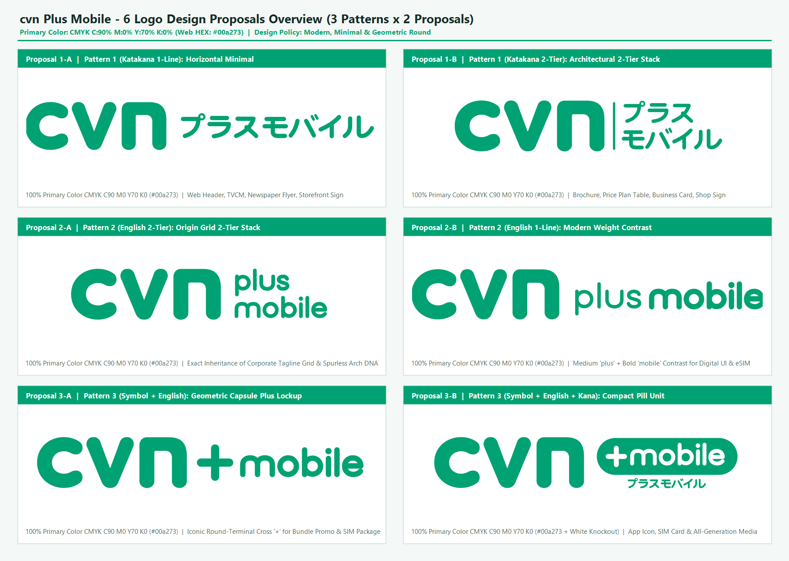
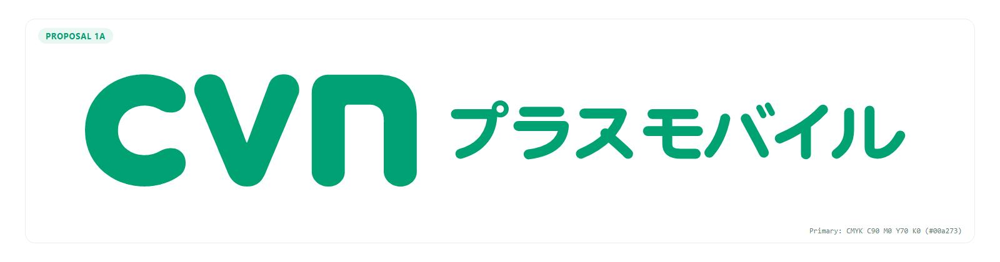
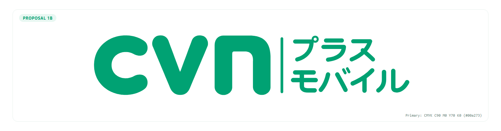
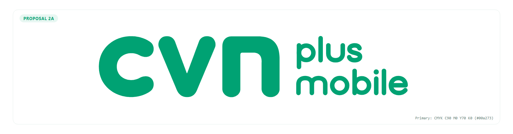
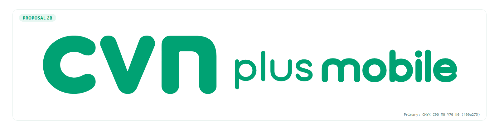
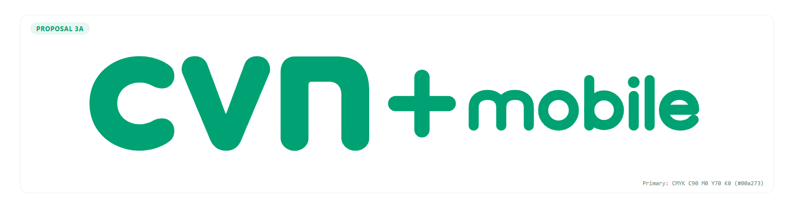

# 株式会社cvn モバイル事業新ブランド「cvn プラスモバイル」ロゴデザイン提案書（全6案・CMYK印刷基準＆デジタル統合仕様）

- **作成日**: 2026年11月05日
- **担当部門**: 制作・編集・デザイン部門（`02_Creative_Dept`）
- **対象サービス**: 株式会社cvn（旧・株式会社飯田ケーブルテレビ／創立40周年・2026年5月1日社名変更）モバイル通信事業「cvn プラスモバイル」
- **プライマリーカラー規定（厳密指定）**: **CMYK `C:90% M:0% Y:70% K:0%`**（Web/デジタル表示換算値：**`#00a273`** / RGB: `0, 162, 115`）
- **デザイン基本方針**: **「現代的でモダン、シンプル」**（親ロゴ `cvn` の極太ラウンドジオメトリック造形・カプセル端子・左上突起のない滑らかなアーチDNAを100%継承）

---

## 1. エグゼクティブ・サマリー＆ブランドデザイン基本方針

### 1-1. プロジェクト背景とブランドの使命
2026年5月1日、創立40周年の節目に株式会社飯田ケーブルテレビから社名を刷新した**「株式会社cvn（cast vision network）」**は、地域の放送・通信インフラを支える総合情報通信企業として新たなステージへ踏み出しました。
その主力サービスである**「cvn プラスモバイル」**は、光テレビ（光キャストTV）や光インターネット（いい-NET光）にスマートフォンのモバイル回線を「プラス」することで家計の通信費全体を最適化し、さらに大手オンライン専用ブランドには真似のできない**「地域スタッフによる対面・電話でのきめ細やかなサポート」**を提供する戦略的サービスです。

本提案書では、オーナーより提示された最優先指針**「現代的でモダン、シンプル」**および**「CMYK `C:90% M:0% Y:70% K:0%`（`#00a273`）」**を厳格に遵守し、3つの表記パターン（「プラスモバイル」「plus mobile」「+mobile」）それぞれに明確な設計意図を持たせた**計6案のロゴデザインシステム**を提示します。

### 1-2. デザイン3大原則（現代的・モダン・シンプルの具現化）
1. **ノイズレスな造形純度（No Decorative Noise）**
   - 電波マーク、スマホのイラスト、キラキラした装飾、多色グラデーションなどの前時代的な視覚ノイズを一切排除しました。
   - 2026年のグローバル通信ブランドデザインの主流である**「Strict Structure, Soft Execution（厳密な幾何学グリッドと、柔らかく親しみやすいカプセル端子の両立）」**に基づき、線の太さ（ウェイト）、正円アーク、そして洗練された余白（ホワイトスペース）のみでブランドの品格を表現しています。
2. **親ブランド `cvn` の造形DNA完全継承（100% DNA Inheritance）**
   - 原画の左側に配置された `cvn` マークの実ピクセル輪郭（サブピクセル精度）を忠実に抽出し、その最大の特徴である**「極太ラウンドストローク」「半円カプセル端子（Round Cap）」「`n` の左上突起（スパール）を排した滑らかな `∩` アーチ」**を、新設するカタカナ・欧文・`+` 記号のすべてに一貫して適用しました。
3. **CMYK `C:90% M:0% Y:70% K:0%` を核とする高純度カラーマネジメント**
   - 印刷物（SIMパッケージ、店舗看板、折込チラシ、パンフレット、名刺）において黒インキ（`K`版）を一切混入させない **`K:0%` の純粋な2色掛け合わせ（`C:90% + Y:70%`）**を基準とすることで、オフセット印刷およびオンデマンド印刷において濁りのない鮮烈なコーポレート・エメラルドグリーンを実現します。

---

## 2. メインロゴ `cvn` の造形・グリッド・色彩解析と継承ルール

### 2-1. 原画（`1024 × 226 px`）の幾何学グリッド解析
原画の精密計測により、株式会社cvnのコーポレートロゴは以下の数学的秩序で構成されていることが確認されました。

| 構成要素 | 座標範囲（原画 1024×226px 基準） | 寸法・比率データ | 造形上の核心的特徴（DNA） |
| :--- | :--- | :--- | :--- |
| **`c`（左第1文字）** | `X: 0 .. 200`, `Y: 0 .. 223` | 幅 `201px` × 高さ `224px` ストローク太さ `63〜66px` | 正円をベースとし、右側開口部（アパーチャー）を大きく開いた高視認性アーク。上下の先端は完全な半円カプセル（半径約 `31.5px`）。 |
| **`v`（中央文字）** | `X: 217 .. 426`, `Y: 0 .. 223` | 幅 `210px` × 高さ `224px` 文字間ガター `17px` | 左右対称（シンメトリー）の斜めカプセルストローク。底部頂点（`X: 322, Y: 223`）も鋭角ではなく滑らかな円弧で結ばれている。 |
| **`n`（右第3文字）** | `X: 451 .. 659`, `Y: 1 .. 223` | 幅 `209px` × 高さ `223px` 左右ステム幅 `66px` / 頂部厚 `60px` | **最重要造形特徴**：一般的な小文字 `n` にある左上の縦突起（スパール）を完全に排除し、左ステムからそのまま半円アーチへつながる**純粋なトンネル型（`∩`型）**で構成されている。 |
| **センターガター** | `X: 660 .. 720` | 幅 `61px`（全幅の約 `6.0%`） | メインロゴ `cvn` のステム幅（`60〜66px`）とほぼ `1 : 1` の黄金リズムを成す空白領域。 |
| **右タグライン領域** | `X: 721 .. 1023`, `Y: 0 .. 209` | 幅 `303px` × 3段スタック ストローク太さ `12〜14px` | `cast / vision / network` を小文字ラウンドサンセリフ体で3段左揃え配置。`n` や `m` も親ロゴ同様にスパール（突起）を持たない連続アーチで統一されている。 |

### 2-2. 色彩設計規定（CMYK印刷基準値 ＆ Webデジタル換算値）

オーナー指示に基づき、すべての制作物（印刷・サイン・Web・映像）において以下のカラーパレット規定を適用します。

| カラー役割 | 名称 | **CMYK（印刷・制作主基準）** | **HEX（Web/RGB）** | **RGB値** | 色彩設計および印刷工学上のねらい |
| :--- | :--- | :--- | :--- | :--- | :--- |
| **プライマリーカラー** （全案共通・主色） | **cvn エメラルドグリーン** | **`C:90% M:0% Y:70% K:0%`** | **`#00a273`** | `0, 162, 115` | **【最重要】M（マゼンタ）とK（ブラック）を0%にした純粋なシアン90%＋イエロー70%の2版構成。** インキの濁りや暗沈みを完全に防ぎ、新聞折込チラシや店舗看板でも澄み切った先進的グリーンを発色させる。また2版のみのため、小サイズ文字での版ズレ（見当ズレ）リスクを最小化できる。 |
| **セカンダリー濃色** （案1-B / 案3-B 補助色） | **ディープ・フォレストスレート** | **`C:85% M:45% Y:65% K:70%`** （※単色スミ版時は `K:85%`） | **`#142E28`** | `20, 46, 40` | 純粋な黒（`#000000`）ではなく、グリーンの色相をわずかに含ませた深緑スレート。プライマリーカラー（`C90 Y70`）と組み合わせた際に冷たくなりすぎず、高いコントラスト比（WCAG AAA相当）と落ち着いた信頼感を生む。 |
| **ベース／反転色** （案3-B ピル内文字等） | **ピュアホワイト** | **`C:0% M:0% Y:0% K:0%`** （用紙白抜き） | **`#FFFFFF`** | `255, 255, 255` | カプセルバッジ（`C90 M0 Y70 K0` 塗り）の上に白抜き（`C0 M0 Y0 K0`）で文字を配置することで、遠距離からの視認性とデジタルUIでのアイコニック性を最大化する。 |

---

## 3. ロゴデザイン全6案 詳細プレゼンテーション

### 【パターン①：日本語表記「プラスモバイル」（`cvn プラスモバイル`）× 2案】
地域の全世代（シニア層・ファミリー層・既存ケーブルテレビ加入者）が、一目で「cvnのスマホサービス」と直感的に理解できる日本語表記パターンです。カタカナ特有の「野暮ったさ」や「格安スマホ的なチープさ」を払拭するため、直線と正円アーク、そして `cvn` 共通の半円カプセル端子のみで設計したオリジナル・ジオメトリック・カタカナを開発しました。

---

#### ■ 案1-A：ミニマル・ラウンド・ホリゾンタル（現代的1行横並び・単色案）

- **SVGファイル**: [`02_Creative_Dept/final_outputs/logo_1A.svg`](../final_outputs/logo_1A.svg)
- **デザインコンセプト**: **「Pure Horizontal Harmony（純粋なる1行の調和）」**
- **配色仕様**: 全体 **CMYK `C:90% M:0% Y:70% K:0%`（`#00a273`）単色**
- **採用理由（Why This Works）**:
  - 親ロゴ `cvn` の右側に、ステム幅（`66px`）と同一の黄金ガターを空けて「プラスモバイル」を1行でストレートに配置した、最も王道かつ誤読ゼロのロックアップです。
  - 単色（`C90 M0 Y70 K0`）のみで完結するため、1色刷りの封筒や新聞広告からWebサイトのグローバルナビゲーションまで、媒体を選ばず100%の再現性を誇ります。
- **デザインのねらい・造形意図**:
  - カタカナ7文字（「プ・ラ・ス・モ・バ・イ・ル」）のすべての始点・終点・折れ曲がり部に、親ロゴ `cvn` と全く同じ**完全半円カプセル端子（`stroke-linecap="round"`）**を採用しました。
  - 「プ」の半濁点（`゜`）を正円リングで、「モ」のL字脚や「ル」の跳ね上げを親ロゴ `n` のアーチ曲率と揃えることで、欧文 `cvn` と和文カタカナが最初から1つのフォントファミリーであったかのような高度な一体感を実現しています。
- **推奨利用シーン**: 公式Webサイトヘッダー、テレビCMテロップ、新聞折込チラシ表題、店舗ファサード看板（横長面）。

---

#### ■ 案1-B：アーキテクチャル・2段スタック（モダン構造ロックアップ・2トーン案）

- **SVGファイル**: [`02_Creative_Dept/final_outputs/logo_1B.svg`](../final_outputs/logo_1B.svg)
- **デザインコンセプト**: **「Architectural Grid & Contrast（建築的2段グリッドと知的な色彩対比）」**
- **配色仕様**:
  - `cvn` ＋ 上段「プラス」：**CMYK `C:90% M:0% Y:70% K:0%`（`#00a273`）**
  - 下段「モバイル」：**CMYK `C:85% M:45% Y:65% K:70%`（`#142E28` ディープ・フォレストスレート）**
- **採用理由（Why This Works）**:
  - 横に長くなりがちなカタカナ7文字を「プラス（3文字）」と「モバイル（4文字）」の2段にスタックすることで、全体の横幅を約28%コンパクトに凝縮し、原画（`cast / vision / network`）に近い黄金アスペクト比を実現しました。
  - 「cvn ＋ プラス」を同じエメラルドグリーンで結び、「モバイル」を濃色スレートで引き締めることで、**「cvnにプラスするモバイルサービス」**という文脈が視覚的な色分けによって瞬時に伝わります。
- **デザインのねらい・造形意図**:
  - `cvn` とカタカナ領域の間に、端部を丸めた繊細なカプセルバーティカルライン（垂直ディバイダー）を配置し、モダンで整理された建築的グリッド感を演出しています。
  - 上段「プラス」の天端と下段「モバイル」の底端が、左側の `cvn` の天地高（`224px`）にピタリと揃うよう設計しており、名刺やパンフレットの表紙に置いた際の安定感が抜群です。
- **推奨利用シーン**: パンフレット・カタログ表紙、料金プラン比較表、名刺・社員証、店舗ガラス面サイン。

---

### 【パターン②：英語フルテキスト表記「plus mobile」（`cvn plus mobile`）× 2案】
原画の右側に配されたタグライン `cast / vision / network` の小文字ラウンドサンセリフ体の遺伝子を最もダイレクトに引き継ぐ、スタイリッシュで都会的な英語フル表記パターンです。

---

#### ■ 案2-A：オリジン・2段グリッド（原画タグライン構造・完全継承案）

- **SVGファイル**: [`02_Creative_Dept/final_outputs/logo_2A.svg`](../final_outputs/logo_2A.svg)
- **デザインコンセプト**: **「Pure Origin DNA（原画コーポレートロゴからの正統進化）」**
- **配色仕様**: 全体 **CMYK `C:90% M:0% Y:70% K:0%`（`#00a273`）単色**
- **採用理由（Why This Works）**:
  - 原画の右3段組（`cast / vision / network`）が配置されている開始座標（`X: 721`）と天地高（`Y: 0..223`）のグリッドを1ミリも狂わせずに継承し、2段組の `plus` / `mobile` へと置き換えた**最も純正（オーセンティック）なブランドエクステンション案**です。
  - コーポレートロゴと並べた際にも一切の違和感がなく、株式会社cvnの公式サブブランドとしての格式と統一感を最高レベルで担保します。
- **デザインのねらい・造形意図**:
  - **【核心ディテール】スパール（突起）を排した連続アーチ造形**：親ロゴ `cvn` の `n` が左上突起のない純粋なトンネル型（`∩`）であることに合わせ、`plus` の **`u`（逆トンネル型 `∪`）**および `mobile` の **`m`（2連トンネル型 `∩∩`）**からも角や突起を完全に排除しました。
  - さらに `p` と `b` のボウル（円環部）を正円ストロークの接線結合で設計し、`e` の開口部も親ロゴ `c` の広いアパーチャー角と統一することで、原画と100%同じ造形言語で統一しています。
- **推奨利用シーン**: ブランドガイドライン基準ロゴ、コーポレートサイト、SIMカード台紙、公式契約書類、プレスリリース。

---

#### ■ 案2-B：モダン・ウェイトコントラスト（1行スマート・タイポグラフィ案）

- **SVGファイル**: [`02_Creative_Dept/final_outputs/logo_2B.svg`](../final_outputs/logo_2B.svg)
- **デザインコンセプト**: **「Typographic Weight Rhythm（線の太さの対比が生む現代的リズム）」**
- **配色仕様**: 全体 **CMYK `C:90% M:0% Y:70% K:0%`（`#00a273`）単色**
- **採用理由（Why This Works）**:
  - 枠線や色分けすら使わず、**`plus`（ミディアム・ラウンドウェイト）と `mobile`（ボールド・ラウンドウェイト）のストローク太さの対比（約 `1 : 1.54`）と余白のみ**で2単語を鮮やかに分離・強調した、極めて現代的でミニマルな1行案です。
  - グローバルIT企業や最新デジタルプロダクトの命名ロックアップ（例：AppleやGoogleのサービスロゴ体系）に通じるスマートさがあり、若年層・デジタル層への訴求力に優れます。
- **デザインのねらい・造形意図**:
  - `cvn`（極太 `66px` 相当）➔ `plus`（軽やかな中太 `15px` 相当）➔ `mobile`（力強い太字 `23px` 相当）という「太・細・中太」の視覚的リズムを作ることで、単色1行でありながら視線が自然に左から右へ流れ、最終単語である `mobile` が強く印象に残るよう設計しています。
- **推奨利用シーン**: スマートフォン用マイページUI、eSIM開通画面、Webサービスヘッダー、デジタルサイネージ、SNSバナー。

---

### 【パターン③：記号＋英語表記「+mobile」（`cvn + mobile` / `cvn +mobile`）× 2案】
「今の暮らし（光テレビ・光ネット）にモバイルをプラスする」というサービスの本質を、最も象徴的な記号 **`+`（プラス）** によって視覚化したアイコニック・パターンです。

---

#### ■ 案3-A：ジオメトリック・カプセルプラス（正十字ロックアップ・単色案）

- **SVGファイル**: [`02_Creative_Dept/final_outputs/logo_3A.svg`](../final_outputs/logo_3A.svg)
- **デザインコンセプト**: **「The Iconic Capsule Cross（ブランドの価値をつなぐ象徴的カプセルクロス）」**
- **配色仕様**: 全体 **CMYK `C:90% M:0% Y:70% K:0%`（`#00a273`）単色**
- **採用理由（Why This Works）**:
  - 親ロゴ `cvn` と `mobile` の間に、余計な装飾を一切排した純粋な正十字 **`+`** を配置することで、**「cvn（放送・光通信）＋ mobile（スマホ）＝ セットでつながる・豊かになる」**という事業コンセプトを0.1秒で直感させる、視覚的フック（アイキャッチ性）最強のシンプル案です。
- **デザインのねらい・造形意図**:
  - 中央の `+` 記号（外寸 `124 × 124 px`、線幅 `36px`）を、親ロゴ `cvn` のストロークと同じ完全半円カプセル端子（Round Cap）の水平・垂直クロスで設計しました。
  - `cvn` の `n` の右ステム、`+` の水平バー、そして `mobile` の `m` のアーチが心地よい水平軸（Xハイト中心線 `Y: 112`）で貫かれており、シンプルでありながら強いシンボル性を放ちます。また、正方形アイコン（ファビコン等）では **`cvn` の右上に `+` を添える短縮展開**も自在に行えます。
- **推奨利用シーン**: 「光ネット＋スマホ」セット割キャンペーン広告、SIMパッケージ表面、店頭ポスター、WebLPファーストビュー。

---

#### ■ 案3-B：コンパクト・ピルユニット（カプセルバッジ＋カナ併記ハイブリッド案）
![案3-B：cvn [+mobile] プラスモバイル（Compact Pill Unit）](../final_outputs/logo_3B.png)
- **SVGファイル**: [`02_Creative_Dept/final_outputs/logo_3B.svg`](../final_outputs/logo_3B.svg)
- **デザインコンセプト**: **「Modern Product Badge & Universal Readability（現代的カプセルバッジと全世代可読性の融合）」**
- **配色仕様**:
  - `cvn` およびカプセルピル背景：**CMYK `C:90% M:0% Y:70% K:0%`（`#00a273`）**
  - ピル内 `+mobile` 文字：**ピュアホワイト `C:0% M:0% Y:0% K:0%`（`#FFFFFF` 白抜き）**
  - 下部サブテキスト「プラスモバイル」：**CMYK `C:85% M:45% Y:65% K:70%`（`#142E28` ディープ・フォレストスレート）**
- **採用理由（Why This Works）**:
  - パターン③（`+mobile`）が持つ「デジタルプロダクトとしての先進性・アイコン適性」と、パターン①（`プラスモバイル`）が持つ「シニア層まで迷わず読める日本語の親切さ」を、**カプセルピル（錠剤型バッジ）＋下部カナ併記**というモダンなUI構造で1つに統合したハイブリッド完成形です。
- **デザインのねらい・造形意図**:
  - 親ロゴ `cvn` のストローク先端（カプセル形状）をそのまま拡大したような**両端完全半円のピルコンテナ（高さ `162px`、角丸半径 `R=81px`）**の中に、白抜きの `+mobile` を高密度にロックアップしました。
  - ピルの下部に、ピル幅に合わせて端正に字詰めしたジオメトリック・カタカナ「プラスモバイル」を添えることで、「`+mobile` を何と読むのか」という初見ユーザーの迷いをゼロにしつつ、ピル単体（`[+mobile]`）を切り出せばそのままスマホアプリのアイコンやSIMカードの刻印として機能する高いモジュール性を備えています。
- **推奨利用シーン**: スマートフォンアプリアイコン、SIMカード本体刻印、店頭のぼり旗・スタッフユニフォームバッジ、全世代向け総合パンフレット。

---

## 4. 全6案の比較評価マトリクスと導入推奨ガイドライン

### 4-1. 6案比較評価マトリクス

| 評価軸 ＼ 提案番号 | **案1-A** `cvn プラスモバイル` （1行単色） | **案1-B** `cvn プラス/モバイル` （2段2トーン） | **案2-A** `cvn plus/mobile` （原画2段継承） | **案2-B** `cvn plus mobile` （1行ウェイト差） | **案3-A** `cvn + mobile` （カプセル`+`単色） | **案3-B** `cvn [+mobile]` （ピル＋カナ併記） |
| :--- | :---: | :---: | :---: | :---: | :---: | :---: |
| **① 全世代・シニア層への瞬時の判読性** | **★★★★★** （最良・誤読ゼロ） | **★★★★★** （最良・塊で読める） | ★★★☆☆ （欧文のみ） | ★★★☆☆ （欧文のみ） | ★★★★☆ （`+`で直感理解） | **★★★★★** （カナ併記で万全） |
| **② 現代的・モダン・スマートな印象** | ★★★★☆ | ★★★★☆ | **★★★★★** | **★★★★★** | **★★★★★** | **★★★★★** |
| **③ 親ロゴ `cvn` 原画との一体感・純度** | ★★★★☆ | ★★★★☆ | **★★★★★** （原画グリッド一致） | ★★★★☆ | **★★★★★** （カプセル造形一致） | ★★★★☆ |
| **④ 省スペース性（横幅のコンパクトさ）** | ★★★☆☆ （横長比率） | **★★★★★** （2段凝縮） | **★★★★★** （2段凝縮） | ★★★☆☆ （横長比率） | ★★★★☆ | ★★★★☆ |
| **⑤ アイコン・バッジ・セット割訴求力** | ★★★☆☆ | ★★★★☆ | ★★★★☆ | ★★★★☆ | **★★★★★** （`+`が象徴的） | **★★★★★** （ピル単体展開可） |
| **⑥ 単色印刷・1版刷りへの適応性** | **★★★★★** （C90 Y70 単色） | ★★★★☆ （単色化も容易） | **★★★★★** （C90 Y70 単色） | **★★★★★** （C90 Y70 単色） | **★★★★★** （C90 Y70 単色） | ★★★★☆ （白抜き反転） |

### 4-2. ブランド戦略に応じた推奨セレクション（意思決定ガイド）

1. **【コーポレート統一・デザインの純度重視なら】➔ 案2-A（`cvn plus / mobile`）または 案3-A（`cvn + mobile`）**
   - 原画 `cast / vision / network` のグリッドと `C:90% M:0% Y:70% K:0%` 単色のストイックな美しさを100%継承したい場合は **案2-A**、そこに「セット割（プラス）」の記号的インパクトを加えたい場合は **案3-A** が最適です。
2. **【飯田下伊那地域の全世代・シニア層への普及とデジタル展開の両立なら】➔ 案3-B（`cvn [+mobile] プラスモバイル`）または 案1-A / 1-B**
   - チラシや看板で高齢者層にも一目で「プラスモバイル」と読ませつつ、スマホブランドとしての先進的なバッジ感（ピル造形）を打ち出したい場合は **案3-B** が最も高いマーケティング効果を発揮します。
3. **【実運用における「マルチロックアップ（併用）システム」のご提案】**
   - 現代の通信ブランド（J:COM MOBILEやmineo等）と同様に、1案のみに限定せず、たとえば **「ブランド規定・SIM台紙・Webヘッダーの基本形＝案3-A（または案2-A）」＋「新聞チラシ・店頭看板の日本語明示形＝案1-A（または案3-B）」** のように、同一デザインDNAを持つシリーズとして用途別に使い分ける運用も極めて有効です。

### 4-3. ロゴ運用レギュレーション（最小サイズ・アイソレーション・CMYK入稿規定）

- **アイソレーション（不可侵余白領域）**:
  - ロゴの周囲には、親ロゴ `cvn` のステム太さ `S`（原画基準 `66px`、全高 `H` の約 `30%`）以上の余白（四方 `0.3H` 以上）を必ず確保し、他の文字や枠線が干渉しないよう配置してください。
- **最小使用サイズ（Minimum Size）**:
  - **印刷物（CMYK 300〜350dpi）**：ロゴ天地高 **`5.0 mm` 以上**（案3-Bのカナ併記版は天地高 **`7.0 mm` 以上**）。
  - **デジタル画面（Web / UI）**：ロゴ天地高 **`24 px` 以上**（24px未満のファビコン等では `cvn` または `[+m]` の短縮シンボルを使用）。
- **印刷データ入稿時の厳守事項（CMYK `C:90% M:0% Y:70% K:0%` 維持）**:
  - Illustrator（`.ai` / `.pdf`）等で印刷所へ入稿する際は、RGBからの自動CMYK変換プロファイル（Japan Color 2001 Coated等）によるK版混入（例：`C85 M0 Y68 K5` 等への意図せぬ変化）を防ぐため、必ずスウォッチのプロセスカラー値を **`C=90, M=0, Y=70, K=0`** に手動ロックして入稿してください。

---

## 5. 参考情報・出典
- 株式会社cvn 公式ウェブサイト（旧・株式会社飯田ケーブルテレビ / 2026年5月1日社名変更・創立40周年）：https://castvision.net/
- 株式会社cvn コーポレートロゴ原画解析データ（`1024 × 226 px`、プライマリーカラー CMYK `C:90% M:0% Y:70% K:0%` / Web HEX `#00a273`）
- リサーチ部門調査レポート：[`01_Research_Dept/reports/report_cvn_plus_mobile_logo.md`](../../01_Research_Dept/reports/report_cvn_plus_mobile_logo.md)
