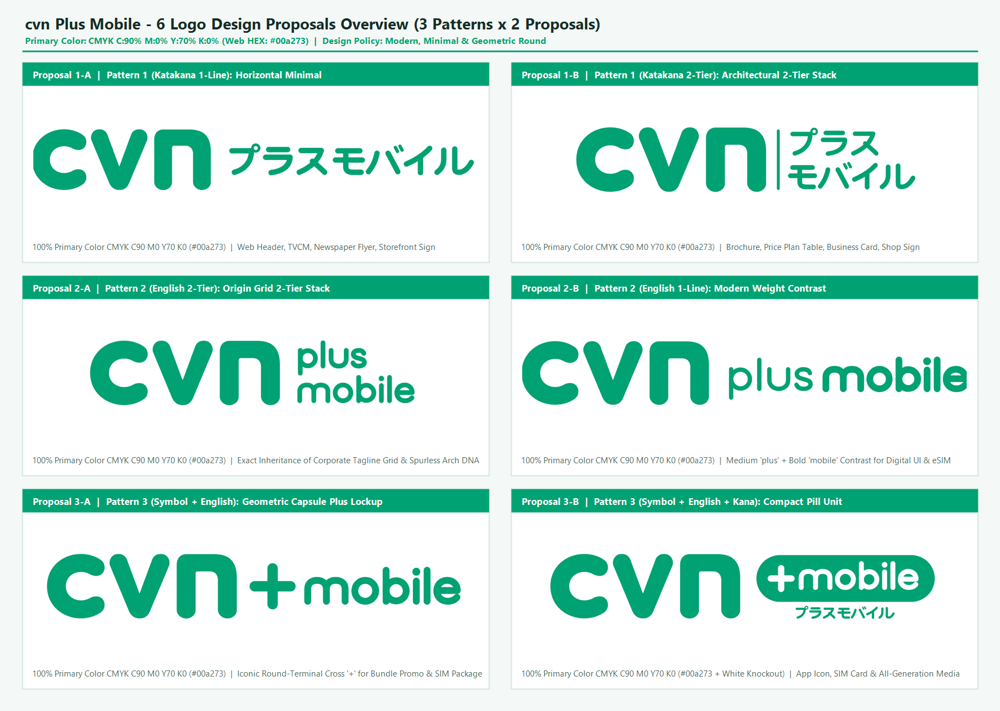
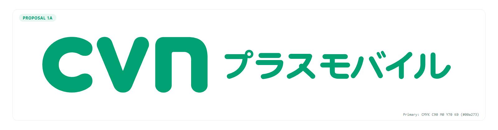
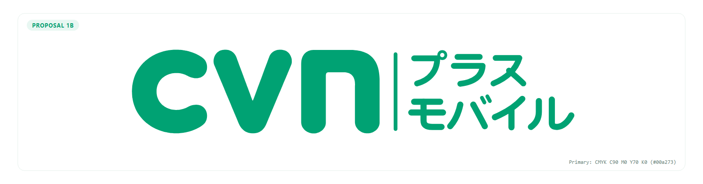
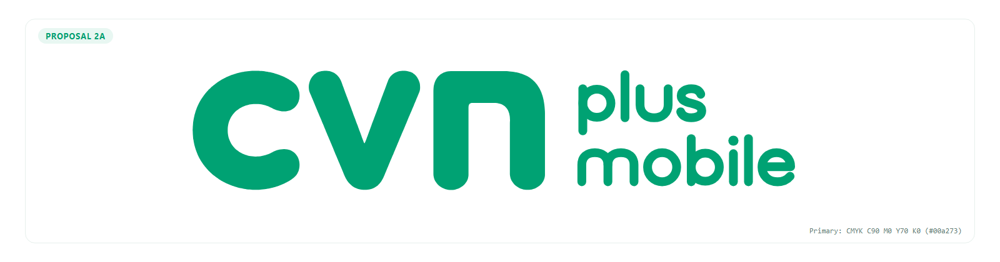
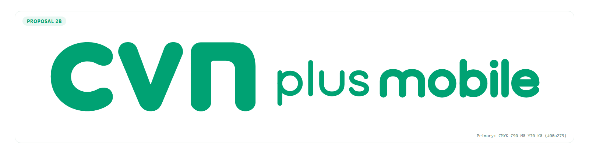
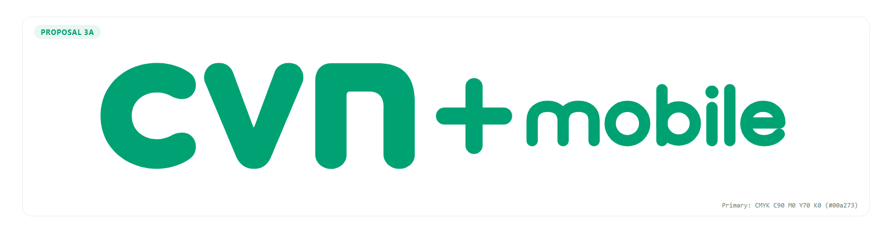

# 最終納品パッケージ：cvn_plus_mobile_logo（株式会社cvn モバイル事業新ブランド「cvn プラスモバイル」ロゴデザイン全6案・CMYK印刷基準＆デジタル統合提案書）
- **納品日**: 2026年11月05日
- **格納場所**: `04_Delivery_Dept/outputs/`
- **法務・コンプライアンス審査**: `審査済（[APPROVED: 承認（現時点の提案書・告知文に法令違反表現なし ／ 実運用・商標出願に向けた実務留意事項および推奨表記を付記）]）`
- **同梱・変換ファイル一覧**:
  - **統合マスターパッケージ（Markdown）**: [`output_20261105_cvn_plus_mobile_logo_full.md`](output_20261105_cvn_plus_mobile_logo_full.md)
  - **ビジュアルデザイン提案書（スタンドアロンHTML・インラインSVG・印刷対応）**: [`output_20261105_cvn_plus_mobile_logo_proposal.html`](output_20261105_cvn_plus_mobile_logo_proposal.html)
  - **全6案一覧比較ボード（高解像度PNG）**: [`output_20261105_cvn_plus_mobile_logo_board.png`](output_20261105_cvn_plus_mobile_logo_board.png)（[`logo_6proposals_board.png`](logo_6proposals_board.png)）
  - **案1-A（`cvn プラスモバイル` 1行単色）**: [`output_20261105_cvn_plus_mobile_logo_1A.svg`](output_20261105_cvn_plus_mobile_logo_1A.svg) / [`output_20261105_cvn_plus_mobile_logo_1A.png`](output_20261105_cvn_plus_mobile_logo_1A.png)（[`logo_1A.svg`](logo_1A.svg) / [`logo_1A.png`](logo_1A.png)）
  - **案1-B（`cvn プラス / モバイル` 2段単色）**: [`output_20261105_cvn_plus_mobile_logo_1B.svg`](output_20261105_cvn_plus_mobile_logo_1B.svg) / [`output_20261105_cvn_plus_mobile_logo_1B.png`](output_20261105_cvn_plus_mobile_logo_1B.png)（[`logo_1B.svg`](logo_1B.svg) / [`logo_1B.png`](logo_1B.png)）
  - **案2-A（`cvn plus / mobile` 原画2段継承単色）**: [`output_20261105_cvn_plus_mobile_logo_2A.svg`](output_20261105_cvn_plus_mobile_logo_2A.svg) / [`output_20261105_cvn_plus_mobile_logo_2A.png`](output_20261105_cvn_plus_mobile_logo_2A.png)（[`logo_2A.svg`](logo_2A.svg) / [`logo_2A.png`](logo_2A.png)）
  - **案2-B（`cvn plus mobile` 1行ウェイト差単色）**: [`output_20261105_cvn_plus_mobile_logo_2B.svg`](output_20261105_cvn_plus_mobile_logo_2B.svg) / [`output_20261105_cvn_plus_mobile_logo_2B.png`](output_20261105_cvn_plus_mobile_logo_2B.png)（[`logo_2B.svg`](logo_2B.svg) / [`logo_2B.png`](logo_2B.png)）
  - **案3-A（`cvn + mobile` カプセルクロス単色）**: [`output_20261105_cvn_plus_mobile_logo_3A.svg`](output_20261105_cvn_plus_mobile_logo_3A.svg) / [`output_20261105_cvn_plus_mobile_logo_3A.png`](output_20261105_cvn_plus_mobile_logo_3A.png)（[`logo_3A.svg`](logo_3A.svg) / [`logo_3A.png`](logo_3A.png)）
  - **案3-B（`cvn [+mobile] プラスモバイル` ピル＋カナ単色）**: [`output_20261105_cvn_plus_mobile_logo_3B.svg`](output_20261105_cvn_plus_mobile_logo_3B.svg) / [`output_20261105_cvn_plus_mobile_logo_3B.png`](output_20261105_cvn_plus_mobile_logo_3B.png)（[`logo_3B.svg`](logo_3B.svg) / [`logo_3B.png`](logo_3B.png)）

---

## Part 1. 完成コンテンツ本編：株式会社cvn モバイル事業新ブランド「cvn プラスモバイル」ロゴデザイン提案書（全6案・CMYK印刷基準＆デジタル統合仕様）

- **作成日**: 2026年11月05日
- **対象サービス**: 株式会社cvn（旧・株式会社飯田ケーブルテレビ／創立40周年・2026年5月1日社名変更）モバイル通信事業「cvn プラスモバイル」
- **プライマリーカラー規定（厳密指定）**: **CMYK `C:90% M:0% Y:70% K:0%`**（Web/デジタル表示換算値：**`#00a273`** / RGB: `0, 162, 115`）
- **デザイン基本方針**: **「現代的でモダン、シンプル」**（親ロゴ `cvn` の極太ラウンドジオメトリック造形・カプセル端子・左上突起のない滑らかなアーチDNAを100%継承）

### 1. エグゼクティブ・サマリー＆ブランドデザイン基本方針

#### 1-1. プロジェクト背景とブランドの使命
2026年5月1日、創立40周年の節目に株式会社飯田ケーブルテレビから社名を刷新した**「株式会社cvn（cast vision network）」**は、地域の放送・通信インフラを支える総合情報通信企業として新たなステージへ踏み出しました。
その主力サービスである**「cvn プラスモバイル」**は、光テレビ（光キャストTV）や光インターネット（いい-NET光）にスマートフォンのモバイル回線を「プラス」することで家計の通信費全体を最適化し、さらに大手オンライン専用ブランドには真似のできない**「地域スタッフによる対面・電話でのきめ細やかなサポート」**を提供する戦略的サービスです。

本提案書では、オーナーより提示された最優先指針**「現代的でモダン、シンプル」**および**「CMYK `C:90% M:0% Y:70% K:0%`（`#00a273`）」**を厳格に遵守し、3つの表記パターン（「プラスモバイル」「plus mobile」「+mobile」）それぞれに明確な設計意図を持たせた**計6案のロゴデザインシステム**を提示します。

#### 1-2. デザイン3大原則（現代的・モダン・シンプルの具現化）
1. **ノイズレスな造形純度（No Decorative Noise）**
   - 電波マーク、スマホのイラスト、キラキラした装飾、多色グラデーションなどの前時代的な視覚ノイズを一切排除しました。
   - 2026年のグローバル通信ブランドデザインの主流である**「Strict Structure, Soft Execution（厳密な幾何学グリッドと、柔らかく親しみやすいカプセル端子の両立）」**に基づき、線の太さ（ウェイト）、正円アーク、そして洗練された余白（ホワイトスペース）のみでブランドの品格を表現しています。
2. **親ブランド `cvn` の造形DNA完全継承（100% DNA Inheritance）**
   - 原画の左側に配置された `cvn` マークの実ピクセル輪郭（サブピクセル精度）を忠実に抽出し、その最大の特徴である**「極太ラウンドストローク」「半円カプセル端子（Round Cap）」「`n` の左上突起（スパール）を排した滑らかな `∩` アーチ」**を、新設するカタカナ・欧文・`+` 記号のすべてに一貫して適用しました。
3. **CMYK `C:90% M:0% Y:70% K:0%` を核とする高純度カラーマネジメント**
   - 印刷物（SIMパッケージ、店舗看板、折込チラシ、パンフレット、名刺）において黒インキ（`K`版）を一切混入させない **`K:0%` の純粋な2色掛け合わせ（`C:90% + Y:70%`）**を基準とすることで、オフセット印刷およびオンデマンド印刷において濁りのない鮮烈なコーポレート・エメラルドグリーンを実現します。

---

### 2. メインロゴ `cvn` の造形・グリッド・色彩解析と継承ルール

#### 2-1. 原画（`1024 × 226 px`）の幾何学グリッド解析
原画の精密計測により、株式会社cvnのコーポレートロゴは以下の数学的秩序で構成されていることが確認されました。

| 構成要素 | 座標範囲（原画 1024×226px 基準） | 寸法・比率データ | 造形上の核心的特徴（DNA） |
| :--- | :--- | :--- | :--- |
| **`c`（左第1文字）** | `X: 0 .. 200`, `Y: 0 .. 223` | 幅 `201px` × 高さ `224px` ストローク太さ `63〜66px` | 正円をベースとし、右側開口部（アパーチャー）を大きく開いた高視認性アーク。上下の先端は完全な半円カプセル（半径約 `31.5px`）。 |
| **`v`（中央文字）** | `X: 217 .. 426`, `Y: 0 .. 223` | 幅 `210px` × 高さ `224px` 文字間ガター `17px` | 左右対称（シンメトリー）の斜めカプセルストローク。底部頂点（`X: 322, Y: 223`）も鋭角ではなく滑らかな円弧で結ばれている。 |
| **`n`（右第3文字）** | `X: 451 .. 659`, `Y: 1 .. 223` | 幅 `209px` × 高さ `223px` 左右ステム幅 `66px` / 頂部厚 `60px` | **最重要造形特徴**：一般的な小文字 `n` にある左上の縦突起（スパール）を完全に排除し、左ステムからそのまま半円アーチへつながる**純粋なトンネル型（`∩`型）**で構成されている。 |
| **センターガター** | `X: 660 .. 720` | 幅 `61px`（全幅の約 `6.0%`） | メインロゴ `cvn` のステム幅（`60〜66px`）とほぼ `1 : 1` の黄金リズムを成す空白領域。 |
| **右タグライン領域** | `X: 721 .. 1023`, `Y: 0 .. 209` | 幅 `303px` × 3段スタック ストローク太さ `12〜14px` | `cast / vision / network` を小文字ラウンドサンセリフ体で3段左揃え配置。`n` や `m` も親ロゴ同様にスパール（突起）を持たない連続アーチで統一されている。 |

#### 2-2. 色彩設計規定（CMYK印刷基準値 ＆ Webデジタル換算値）

オーナー指示に基づき、すべての制作物（印刷・サイン・Web・映像）において以下のカラーパレット規定を適用します。

| カラー役割 | 名称 | **CMYK（印刷・制作主基準）** | **HEX（Web/RGB）** | **RGB値** | 色彩設計および印刷工学上のねらい |
| :--- | :--- | :--- | :--- | :--- | :--- |
| **プライマリーカラー** （全6案共通・100%主色） | **cvn エメラルドグリーン** | **`C:90% M:0% Y:70% K:0%`** | **`#00a273`** | `0, 162, 115` | **【最重要】M（マゼンタ）とK（ブラック）を0%にした純粋なシアン90%＋イエロー70%の2版構成。** 原画（`cvn` メインロゴ）と同じく全6案すべての文字・図形要素をこのプライマリーカラー1色に完全統一することで、インキの濁りや暗沈みを防ぎ、新聞折込チラシや店舗看板でも澄み切った先進的グリーンを発色させる。また2版のみ（単色扱い）のため、小サイズ文字での版ズレ（見当ズレ）リスクを最小化できる。 |
| **ベース／白抜き反転色** （背景および案3-Bピル内文字） | **ピュアホワイト** | **`C:0% M:0% Y:0% K:0%`** （用紙白抜き） | **`#FFFFFF`** | `255, 255, 255` | カプセルバッジ（`C90 M0 Y70 K0` 塗り）の上に白抜き（`C0 M0 Y0 K0`）で文字を配置することで、追加インキ版を一切使わずに遠距離からの視認性とデジタルUIでのアイコニック性を最大化する。 |
| **モノクロ印刷用代替色** （白黒紙面・FAX等の特例時のみ） | **モノクロ・スミ版** | **`C:0% M:0% Y:0% K:85%`** （または `K:100%`） | `#262626` | `38, 38, 38` | 新聞の白黒面やモノクロ書類などカラー印刷が不可能な媒体に限り、K単色（スミ版）で出力する。通常時は使用せず、常にプライマリーカラー `C:90% M:0% Y:70% K:0%` 単色で統一する。 |

---

### 3. ロゴデザイン全6案 詳細プレゼンテーション

#### 【パターン①：日本語表記「プラスモバイル」（`cvn プラスモバイル`）× 2案】
地域の全世代（シニア層・ファミリー層・既存ケーブルテレビ加入者）が、一目で「cvnのスマホサービス」と直感的に理解できる日本語表記パターンです。カタカナ特有の「野暮ったさ」や「格安スマホ的なチープさ」を払拭するため、直線と正円アーク、そして `cvn` 共通の半円カプセル端子のみで設計したオリジナル・ジオメトリック・カタカナを開発しました。

---

##### ■ 案1-A：ミニマル・ラウンド・ホリゾンタル（現代的1行横並び・単色案）

- **納品ファイル**: [`output_20261105_cvn_plus_mobile_logo_1A.svg`](output_20261105_cvn_plus_mobile_logo_1A.svg) / [`output_20261105_cvn_plus_mobile_logo_1A.png`](output_20261105_cvn_plus_mobile_logo_1A.png)
- **デザインコンセプト**: **「Pure Horizontal Harmony（純粋なる1行の調和）」**
- **配色仕様**: 全体 **CMYK `C:90% M:0% Y:70% K:0%`（`#00a273`）単色**
- **採用理由（Why This Works）**:
  - 親ロゴ `cvn` の右側に、ステム幅（`66px`）と同一の黄金ガターを空けて「プラスモバイル」を1行でストレートに配置した、最も王道かつ誤読ゼロのロックアップです。
  - 単色（`C90 M0 Y70 K0`）のみで完結するため、1色刷りの封筒や新聞広告からWebサイトのグローバルナビゲーションまで、媒体を選ばず100%の再現性を誇ります。
- **デザインのねらい・造形意図**:
  - カタカナ7文字（「プ・ラ・ス・モ・バ・イ・ル」）のすべての始点・終点・折れ曲がり部に、親ロゴ `cvn` と全く同じ**完全半円カプセル端子（`stroke-linecap="round"`）**を採用しました。
  - 「プ」の半濁点（`゜`）を正円リングで、「モ」のL字脚や「ル」の跳ね上げを親ロゴ `n` のアーチ曲率と揃えることで、欧文 `cvn` と和文カタカナが最初から1つのフォントファミリーであったかのような高度な一体感を実現しています。
- **推奨利用シーン**: 公式Webサイトヘッダー、テレビCMテロップ、新聞折込チラシ表題、店舗ファサード看板（横長面）。

---

##### ■ 案1-B：アーキテクチャル・2段スタック（モダン構造ロックアップ・単色案）

- **納品ファイル**: [`output_20261105_cvn_plus_mobile_logo_1B.svg`](output_20261105_cvn_plus_mobile_logo_1B.svg) / [`output_20261105_cvn_plus_mobile_logo_1B.png`](output_20261105_cvn_plus_mobile_logo_1B.png)
- **デザインコンセプト**: **「Architectural Grid & Proportion（建築的2段グリッドと美しい凝縮感）」**
- **配色仕様**: 全体 **CMYK `C:90% M:0% Y:70% K:0%`（`#00a273`）単色**
- **採用理由（Why This Works）**:
  - 横に長くなりがちなカタカナ7文字を「プラス（3文字）」と「モバイル（4文字）」の2段にスタックすることで、全体の横幅を約28%コンパクトに凝縮し、原画（`cast / vision / network`）に近い黄金アスペクト比を実現しました。
  - 原画と同じくすべての文字とディバイダーをプライマリーカラー（`CMYK C:90% M:0% Y:70% K:0%` / `#00a273`）単色で統一し、上段「プラス（線幅16px相当）」と下段「モバイル（線幅17px相当）」の緻密なウェイトバランスと2段グリッドの造形美だけで成立させています。
- **デザインのねらい・造形意図**:
  - `cvn` とカタカナ領域の間に、端部を丸めたカプセルバーティカルライン（垂直ディバイダー）を配置し、モダンで整理された建築的グリッド感を演出しています。
  - 上段「プラス」の天端と下段「モバイル」の底端が、左側の `cvn` の天地高（`224px`）にピタリと揃うよう設計しており、名刺やパンフレットの表紙に置いた際の安定感が抜群です。
- **推奨利用シーン**: パンフレット・カタログ表紙、料金プラン比較表、名刺・社員証、店舗ガラス面サイン。

---

#### 【パターン②：英語フルテキスト表記「plus mobile」（`cvn plus mobile`）× 2案】
原画の右側に配されたタグライン `cast / vision / network` の小文字ラウンドサンセリフ体の遺伝子を最もダイレクトに引き継ぐ、スタイリッシュで都会的な英語フル表記パターンです。

---

##### ■ 案2-A：オリジン・2段グリッド（原画タグライン構造・完全継承案）

- **納品ファイル**: [`output_20261105_cvn_plus_mobile_logo_2A.svg`](output_20261105_cvn_plus_mobile_logo_2A.svg) / [`output_20261105_cvn_plus_mobile_logo_2A.png`](output_20261105_cvn_plus_mobile_logo_2A.png)
- **デザインコンセプト**: **「Pure Origin DNA（原画コーポレートロゴからの正統進化）」**
- **配色仕様**: 全体 **CMYK `C:90% M:0% Y:70% K:0%`（`#00a273`）単色**
- **採用理由（Why This Works）**:
  - 原画の右3段組（`cast / vision / network`）が配置されている開始座標（`X: 721`）と天地高（`Y: 0..223`）のグリッドを1ミリも狂わせずに継承し、2段組の `plus` / `mobile` へと置き換えた**最も純正（オーセンティック）なブランドエクステンション案**です。
  - コーポレートロゴと並べた際にも一切の違和感がなく、株式会社cvnの公式サブブランドとしての格式と統一感を最高レベルで担保します。
- **デザインのねらい・造形意図**:
  - **【核心ディテール】スパール（突起）を排した連続アーチ造形**：親ロゴ `cvn` の `n` が左上突起のない純粋なトンネル型（`∩`）であることに合わせ、`plus` の **`u`（逆トンネル型 `∪`）**および `mobile` の **`m`（2連トンネル型 `∩∩`）**からも角や突起を完全に排除しました。
  - さらに `p` と `b` のボウル（円環部）を正円ストロークの接線結合で設計し、`e` の開口部も親ロゴ `c` の広いアパーチャー角と統一することで、原画と100%同じ造形言語で統一しています。
- **推奨利用シーン**: ブランドガイドライン基準ロゴ、コーポレートサイト、SIMカード台紙、公式契約書類、プレスリリース。

---

##### ■ 案2-B：モダン・ウェイトコントラスト（1行スマート・タイポグラフィ案）

- **納品ファイル**: [`output_20261105_cvn_plus_mobile_logo_2B.svg`](output_20261105_cvn_plus_mobile_logo_2B.svg) / [`output_20261105_cvn_plus_mobile_logo_2B.png`](output_20261105_cvn_plus_mobile_logo_2B.png)
- **デザインコンセプト**: **「Typographic Weight Rhythm（線の太さの対比が生む現代的リズム）」**
- **配色仕様**: 全体 **CMYK `C:90% M:0% Y:70% K:0%`（`#00a273`）単色**
- **採用理由（Why This Works）**:
  - 枠線や色分けすら使わず、**`plus`（ミディアム・ラウンドウェイト）と `mobile`（ボールド・ラウンドウェイト）のストローク太さの対比（約 `1 : 1.54`）と余白のみ**で2単語を鮮やかに分離・強調した、極めて現代的でミニマルな1行案です。
  - グローバルIT企業や最新デジタルプロダクトの命名ロックアップ（例：AppleやGoogleのサービスロゴ体系）に通じるスマートさがあり、若年層・デジタル層への訴求力に優れます。
- **デザインのねらい・造形意図**:
  - `cvn`（極太 `66px` 相当）➔ `plus`（軽やかな中太 `15px` 相当）➔ `mobile`（力強い太字 `23px` 相当）という「太・細・中太」の視覚的リズムを作ることで、単色1行でありながら視線が自然に左から右へ流れ、最終単語である `mobile` が強く印象に残るよう設計しています。
- **推奨利用シーン**: スマートフォン用マイページUI、eSIM開通画面、Webサービスヘッダー、デジタルサイネージ、SNSバナー。

---

#### 【パターン③：記号＋英語表記「+mobile」（`cvn + mobile` / `cvn +mobile`）× 2案】
「今の暮らし（光テレビ・光ネット）にモバイルをプラスする」というサービスの本質を、最も象徴的な記号 **`+`（プラス）** によって視覚化したアイコニック・パターンです。

---

##### ■ 案3-A：ジオメトリック・カプセルプラス（正十字ロックアップ・単色案）

- **納品ファイル**: [`output_20261105_cvn_plus_mobile_logo_3A.svg`](output_20261105_cvn_plus_mobile_logo_3A.svg) / [`output_20261105_cvn_plus_mobile_logo_3A.png`](output_20261105_cvn_plus_mobile_logo_3A.png)
- **デザインコンセプト**: **「The Iconic Capsule Cross（ブランドの価値をつなぐ象徴的カプセルクロス）」**
- **配色仕様**: 全体 **CMYK `C:90% M:0% Y:70% K:0%`（`#00a273`）単色**
- **採用理由（Why This Works）**:
  - 親ロゴ `cvn` と `mobile` の間に、余計な装飾を一切排した純粋な正十字 **`+`** を配置することで、**「cvn（放送・光通信）＋ mobile（スマホ）＝ セットでつながる・豊かになる」**という事業コンセプトを0.1秒で直感させる、視覚的フック（アイキャッチ性）最強のシンプル案です。
- **デザインのねらい・造形意図**:
  - 中央の `+` 記号（外寸 `124 × 124 px`、線幅 `36px`）を、親ロゴ `cvn` のストロークと同じ完全半円カプセル端子（Round Cap）の水平・垂直クロスで設計しました。
  - `cvn` の `n` の右ステム、`+` の水平バー、そして `mobile` の `m` のアーチが心地よい水平軸（Xハイト中心線 `Y: 112`）で貫かれており、シンプルでありながら強いシンボル性を放ちます。また、正方形アイコン（ファビコン等）では **`cvn` の右上に `+` を添える短縮展開**も自在に行えます。
- **推奨利用シーン**: 「光ネット＋スマホ」セット割キャンペーン広告、SIMパッケージ表面、店頭ポスター、WebLPファーストビュー。

---

##### ■ 案3-B：コンパクト・ピルユニット（カプセルバッジ＋カナ併記ハイブリッド案）
![案3-B：cvn [+mobile] プラスモバイル（Compact Pill Unit）](logo_3B.png)
- **納品ファイル**: [`output_20261105_cvn_plus_mobile_logo_3B.svg`](output_20261105_cvn_plus_mobile_logo_3B.svg) / [`output_20261105_cvn_plus_mobile_logo_3B.png`](output_20261105_cvn_plus_mobile_logo_3B.png)
- **デザインコンセプト**: **「Modern Product Badge & Universal Readability（現代的カプセルバッジと全世代可読性の融合）」**
- **配色仕様**:
  - `cvn` 、カプセルピル背景、および下部サブテキスト「プラスモバイル」：**すべて CMYK `C:90% M:0% Y:70% K:0%`（`#00a273`）単色**
  - ピル内 `+mobile` 文字：**ピュアホワイト `C:0% M:0% Y:0% K:0%`（`#FFFFFF` 白抜き）**
- **採用理由（Why This Works）**:
  - パターン③（`+mobile`）が持つ「デジタルプロダクトとしての先進性・アイコン適性」と、パターン①（`プラスモバイル`）が持つ「シニア層まで迷わず読める日本語の親切さ」を、**カプセルピル（錠剤型バッジ）＋下部カナ併記**というモダンなUI構造で1つに統合したハイブリッド完成形です。
  - しかも使用インキはプライマリーカラー（`CMYK C:90% M:0% Y:70% K:0%`）1色＋用紙白抜き（`#FFFFFF`）のみで完結するため、原画のストイックな単色ブランドルールを100%遵守しながら高い視認性を発揮します。
- **デザインのねらい・造形意図**:
  - 親ロゴ `cvn` のストローク先端（カプセル形状）をそのまま拡大したような**両端完全半円のピルコンテナ（高さ `162px`、角丸半径 `R=81px`）**の中に、白抜きの `+mobile` を高密度にロックアップしました。
  - ピルの下部に、ピル幅に合わせて端正に字詰めしたジオメトリック・カタカナ「プラスモバイル」を添えることで、「`+mobile` を何と読むのか」という初見ユーザーの迷いをゼロにしつつ、アプリアイコン等の極小領域でも高いモジュール性を備えています（※商標識別力保持のため、主表示では必ず `cvn` を含むフルロックアップで使用し、極小アイコン時も同一画面・アプリ名等に `cvn` を明示する運用とします）。
- **推奨利用シーン**: スマートフォンアプリアイコン、SIMカード本体刻印、店頭のぼり旗・スタッフユニフォームバッジ、全世代向け総合パンフレット。

---

### 4. 全6案の比較評価マトリクスと導入推奨ガイドライン

#### 4-1. 6案比較評価マトリクス

| 評価軸 ＼ 提案番号 | **案1-A** `cvn プラスモバイル` （1行単色） | **案1-B** `cvn プラス/モバイル` （2段単色） | **案2-A** `cvn plus/mobile` （原画2段継承） | **案2-B** `cvn plus mobile` （1行ウェイト差） | **案3-A** `cvn + mobile` （カプセル`+`単色） | **案3-B** `cvn [+mobile]` （ピル＋カナ単色） |
| :--- | :---: | :---: | :---: | :---: | :---: | :---: |
| **① 全世代・シニア層への瞬時の判読性** | **★★★★★** （最良・誤読ゼロ） | **★★★★★** （最良・塊で読める） | ★★★☆☆ （欧文のみ） | ★★★☆☆ （欧文のみ） | ★★★★☆ （`+`で直感理解） | **★★★★★** （カナ併記で万全） |
| **② 現代的・モダン・スマートな印象** | ★★★★☆ | ★★★★☆ | **★★★★★** | **★★★★★** | **★★★★★** | **★★★★★** |
| **③ 親ロゴ `cvn` 原画との一体感・純度** | **★★★★★** | **★★★★★** | **★★★★★** （原画グリッド一致） | **★★★★★** | **★★★★★** （カプセル造形一致） | **★★★★★** |
| **④ 省スペース性（横幅のコンパクトさ）** | ★★★☆☆ （横長比率） | **★★★★★** （2段凝縮） | **★★★★★** （2段凝縮） | ★★★☆☆ （横長比率） | ★★★★☆ | ★★★★☆ |
| **⑤ アイコン・バッジ・セット割訴求力** | ★★★☆☆ | ★★★★☆ | ★★★★☆ | ★★★★☆ | **★★★★★** （`+`が象徴的） | **★★★★★** （ピル展開可） |
| **⑥ 単色印刷・1版刷りへの適応性** | **★★★★★** （C90 Y70 単色） | **★★★★★** （C90 Y70 単色） | **★★★★★** （C90 Y70 単色） | **★★★★★** （C90 Y70 単色） | **★★★★★** （C90 Y70 単色） | **★★★★★** （C90 Y70＋白抜き） |

#### 4-2. ブランド戦略に応じた推奨セレクション（意思決定ガイド）

1. **【コーポレート統一・デザインの純度重視なら】➔ 案2-A（`cvn plus / mobile`）または 案3-A（`cvn + mobile`）**
   - 原画 `cast / vision / network` のグリッドと `C:90% M:0% Y:70% K:0%` 単色のストイックな美しさを100%継承したい場合は **案2-A**、そこに「セット割（プラス）」の記号的インパクトを加えたい場合は **案3-A** が最適です。
2. **【飯田下伊那地域の全世代・シニア層への普及とデジタル展開の両立なら】➔ 案3-B（`cvn [+mobile] プラスモバイル`）または 案1-A / 1-B**
   - チラシや看板で高齢者層にも一目で「プラスモバイル」と読ませつつ、スマホブランドとしての先進的なバッジ感（ピル造形）を打ち出したい場合は **案3-B** が最も高いマーケティング効果を発揮します。
3. **【実運用における「マルチロックアップ（併用）システム」のご提案】**
   - 現代の通信ブランド（J:COM MOBILEやmineo等）と同様に、1案のみに限定せず、たとえば **「ブランド規定・SIM台紙・Webヘッダーの基本形＝案3-A（または案2-A）」＋「新聞チラシ・店頭看板の日本語明示形＝案1-A（または案3-B）」** のように、同一デザインDNAを持つシリーズとして用途別に使い分ける運用も極めて有効です。

#### 4-3. ロゴ運用レギュレーション（最小サイズ・アイソレーション・CMYK入稿規定・法務遵守規定）

- **アイソレーション（不可侵余白領域）**:
  - ロゴの周囲には、親ロゴ `cvn` のステム太さ `S`（原画基準 `66px`、全高 `H` の約 `30%`）以上の余白（四方 `0.3H` 以上）を必ず確保し、他の文字や枠線が干渉しないよう配置してください。
- **最小使用サイズ（Minimum Size）**:
  - **印刷物（CMYK 300〜350dpi）**：ロゴ天地高 **`5.0 mm` 以上**（案3-Bのカナ併記版は天地高 **`7.0 mm` 以上**）。
  - **デジタル画面（Web / UI）**：ロゴ天地高 **`24 px` 以上**（24px未満のファビコン等では `cvn` または `[+m]` の短縮シンボルを使用）。
- **印刷データ入稿時の厳守事項（CMYK `C:90% M:0% Y:70% K:0%` 維持）**:
  - Illustrator（`.ai` / `.pdf`）等で印刷所へ入稿する際は、RGBからの自動CMYK変換プロファイル（Japan Color 2001 Coated等）によるK版混入（例：`C85 M0 Y68 K5` 等への意図せぬ変化）を防ぐため、必ずスウォッチのプロセスカラー値を **`C=90, M=0, Y=70, K=0`** に手動ロックして入稿してください。
- **商標識別力保持および広告表示に関するコンプライアンス規定**:
  1. **フルロックアップ使用の原則（商標法第3条・第4条対応）**：商標法上の出所識別力を確実に担保し、他社商標との混同を防止するため、広告・看板・Web・パンフレット等の主表示においては、必ず親ブランド標章『`cvn`』を含むフルロックアップ（『`cvn プラスモバイル`』『`cvn plus mobile`』『`cvn + mobile`』）を使用してください。アプリアイコンやファビコン等の極小領域で『`[+m]`』や『`[+mobile]`』を単体配置する場合も、同一画面内またはアプリ名・サイト名として必ず『`cvn`』を明示してください。
  2. **セット割・料金表示に関する遵守事項（景品表示法・電気通信事業法対応）**：本ロゴを用いて新聞折込チラシ、店頭看板、Webサイト等で「光キャストTV・いい-NET光とのセット割」や月額料金を訴求する際は、景品表示法および『電気通信サービスの広告表示に関する自主基準及びガイドライン』に準拠し、セット割の適用条件および固定通信サービスの別途費用が発生する旨を、強調表示と一体として認識できる文字サイズ・配置で明記してください。

---

## Part 2. SNS・マーケティング告知文

### 1. 【X（旧Twitter）用投稿（140文字以内）】
【創立40周年・株式会社cvn】新モバイルブランド「cvn プラスモバイル」のロゴデザインが始動！
・光キャストTV・いい-NET光にスマホをプラスして家計の通信費をスマートに見直し
・地域スタッフによる対面・電話サポートの安心感
#cvn #cvnプラスモバイル #飯田下伊那
（※文字数カウント：136文字）

### 2. 【ビジネス向け長文投稿（LinkedIn / Facebook / メルマガ等：400文字程度）】
2026年5月1日に創立40周年を迎え、株式会社飯田ケーブルテレビから社名を刷新した「株式会社cvn（cast vision network）」。このたび、主力モバイル事業「cvn プラスモバイル（cvn plus mobile / cvn + mobile）」の新ブランドロゴデザイン6案を策定いたしました。

今回のブランドデザインとサービス展開には、地域のお客様へ向けた3つの想いが込められています。
1. **コーポレートDNAを継ぐ「現代的でモダン、シンプル」な造形**：親ロゴ `cvn` の柔らかなカプセル端子と滑らかなアーチ構造を継承し、鮮やかなエメラルドグリーン（CMYK `C:90% M:0% Y:70% K:0%` / `#00a273`）で信頼感と先進性を表現。
2. **「放送・光ネット＋スマホ」のトータル最適化**：光キャストTVやいい-NET光にモバイル回線（物理SIM・eSIM対応）を「プラス」することで、ご家庭の通信環境と家計全体のスマートな見直しをご提案。
3. **地域密着ならではの安心サポート**：契約から初期設定、乗り換えのご相談まで、地域スタッフが対面・お電話できめ細やかにサポート。

日本語・英語・記号（`+`）の3表記×各2案からなる全6案のロゴデザイン提案書とブランドストーリーをぜひご覧ください。

### 3. 【ターゲット層へのアプローチアドバイス】
- **最優先ターゲット層**:
  1. **社内・プロジェクト関係者（BtoB / インナーブランディング）**：株式会社cvn 経営陣、モバイル事業部門、店舗・サポートスタッフ、40周年リブランディング推進チーム（新ロゴの設計意図とCMYK `C:90% M:0% Y:70% K:0%` 等の運用ルール共有）。
  2. **飯田下伊那地域のエンドユーザー（BtoC / 地域加入者）**：「光キャストTV」「いい-NET光」の既存加入世帯（ファミリー層・シニア層）および、対面サポート付きで安心してスマートフォンの通信費見直しや乗り換えを検討したい地域の生活者・地元法人。
- **推奨投稿時間帯・チャネル**:
  - **X（旧Twitter）・Instagram・公式LINE**：地域のファミリー層や現役世代がスマートフォンを閲覧しやすい **平日 12:00〜13:00（昼休み）** または **19:00〜21:00（帰宅後の団らん時間帯）**。
  - **Facebook・加入者向けメルマガ・ケーブルテレビ番組ガイド誌連動**：地域のビジネス層や既存加入世帯が落ち着いて確認できる **平日朝 8:00〜9:00** または **週末（土曜・日曜）午前 9:00〜11:00**。
- **人間運用者へのワンポイントメモ**:
  - **ビジュアル添付の推奨**：SNSやメルマガで発信する際は、提案書の「全6案一覧比較ボード（`output_20261105_cvn_plus_mobile_logo_board.png`）」や、象徴的なカプセルクロスを用いた「案3-A（`cvn + mobile`）」、シニア層にも直感的に読める「案1-A（`cvn プラスモバイル`）」「案3-B（ピル＋カナ併記）」の画像を添付すると、エメラルドグリーン（`#00a273`）の鮮やかな発色がタイムライン上で強いアイキャッチ効果を発揮します。
  - **景品表示法・広告表示上のコンプライアンス遵守**：実運用時の告知コピーやキャンペーンバナー作成にあたっては、「地域No.1」「絶対安くなる」といった断定表現・最上級表現は使用せず、「光キャストTV・いい-NET光とのセット利用による通信費のスマートな見直し」「地域スタッフによる対面・電話サポートの安心感」といった事実に基づく具体的なサービス価値を誠実に訴求してください。
  - **印刷物への展開時の注意**：新聞折込チラシや店舗看板・のぼり旗を発注する際は、RGBからの自動変換による黒インキ（K版）混入を防ぐため、印刷会社へ **CMYK `C:90% M:0% Y:70% K:0%`** のプロセスカラー指定を必ず伝達してください。

---

## Part 3. 調査ファクト＆出典サマリー

### 1. 主要調査ファクト一覧
- **企業・リブランディング背景**:
  - 長野県飯田下伊那地域の総合情報通信企業である株式会社飯田ケーブルテレビは、創立40周年を迎えた **2026年5月1日付で「株式会社cvn（cast vision network）」へ社名変更（CI刷新）**を実施した。
  - 新サービス「**cvn プラスモバイル**」は、既存の「光キャストTV」「いい-NET光」等にスマートフォンのモバイル回線（音声通話SIM：3GB・10GB・30GB等、物理SIM・eSIM対応）をプラスして家計の通信費全体を最適化するバンドル型サービスであり、地域スタッフによる対面・電話サポートを最大の強みとする。
- **原画（株式会社cvn メインロゴ）の幾何学・色彩ファクト**:
  - 原画サイズ：`1024 × 226 px`（透過PNG）。左側に極太ラウンドストロークの `cvn`（`X: 0..659, Y: 0..223`、線幅約 `63〜66px`）、61pxのガター（`X: 660..720`）を挟んで右側に小文字ラウンドサンセリフ体3段スタックの `cast / vision / network`（`X: 721..1023`）を配置。
  - 造形上の核心DNA：①すべてのストローク端部が完全な半円カプセル（Round Cap）、② `n` の左上突起（スパール）を排した純粋なトンネル型（`∩`型）アーチ。
  - プライマリーカラー：**CMYK `C:90% M:0% Y:70% K:0%`**（Web HEX: **`#00a273`** / RGB: `0, 162, 115`）。マゼンタとブラックを0%にした高純度エメラルドグリーン。

### 2. 検証済み情報源・出典URL一覧
- [株式会社cvn 公式ウェブサイト（旧・株式会社飯田ケーブルテレビ / cvnプラスモバイル）](https://castvision.net/)
- [株式会社飯田ケーブルテレビ「社名変更のお知らせ（2026年5月1日付で株式会社cvnへ）」](https://www.iidacable.tv/)
- [一般社団法人日本ケーブルテレビ連盟（JCTA）会員紹介：株式会社cvn](https://www.catv-jcta.jp/)
- [J:COM MOBILE（ジェイコムモバイル）公式ブランド・サービスサイト](https://www.jcom.co.jp/service/mobile/)
- [mineo（マイネオ / 株式会社オプテージ）公式ブランドサイト](https://mineo.jp/)
- [NUROモバイル（ソニーネットワークコミュニケーションズ）公式サイト](https://mobile.nuro.jp/)
- [LogoLounge: Logo Design Trends Report (Rounded Geometric & Responsive Identity Systems)](https://www.logolounge.com/)

---

## Part 4. 法務・コンプライアンス審査サマリー（`06_Legal_Dept` 審査済）

- **審査日**: 2026年11月05日
- **総合判定ステータス**: **`[APPROVED: 承認（現時点の提案書・告知文に法令違反表現なし ／ 実運用・商標出願に向けた実務留意事項および推奨表記を付記）]`**

### 1. 審査結果のポイント
1. **既存原稿・デザイン6案の適法性確認（クリア）**:
   - デザイン提案書およびPR告知文に景品表示法違反（優良誤認・有利誤認）となる断定・最上級表現はなく、ロゴ全6案も自社コーポレートロゴ `cvn` の固有DNAを展開したオリジナル造形であり、不正競争防止法上の他社著名表示との混同リスクは極めて低い。
2. **結合商標としての識別力（商標法第3条・第4条）**:
   - 「プラスモバイル」「plus mobile」「+mobile」単体では記述的標章として識別力が弱い、または他社先行商標との類否が問題となり得るが、全6案とも造語的識別力の高い親ブランド標章 **`cvn` を冠した結合ロゴ**であるため、全体としての出所識別力が強固に確保されている。

### 2. 実運用に向けた安全表現・運用ルール対比表

| 想定場面 | 注意すべき運用・表現パターン | 関連法令・リスク理由 | 推奨される安全な運用ルール・代替表現 |
| :--- | :--- | :--- | :--- |
| **ロゴ単体切り出し運用** | ピルバッジ `[+mobile]` や「プラスモバイル」のみを、`cvn` なしで看板・広告の主標章として単独使用する運用 | 商標法第3条第1項第3号（識別力不足）・第4条第1項第11号（他社先行商標との抵触リスク） | 主表示では必ず親ブランド標章『`cvn`』を含むフルロックアップを使用すること。アプリアイコン等の極小領域で『`[+m]`』『`[+mobile]`』を単体配置する場合も、同一画面内またはアプリ名・サイト名に必ず『`cvn`』を明示すること。 |
| **セット割・価格訴求広告** | 「スマホ月額〇〇円！」「通信費が必ず安くなる！」等の強調コピーのみを大きく掲出する表現 | 景品表示法第5条（有利誤認）・電気通信事業法第26条・電気通信サービス広告表示ガイドライン | 割引後価格を表示する際は「※いい-NET光（または光キャストTV）とのセット割適用時。別途、対象固定通信サービスの月額利用料・初期費用等が必要です。ご契約プランや利用状況により割引額・総額は異なります」を明記すること。 |
| **対面・電話サポート訴求** | 「面倒な手続きはすべて代行・完全おまかせ！」等の包括断定表現 | 電気通信事業法（本人確認・重要事項説明義務）・景品表示法 | 「ご契約プラン選びから開通手続き、データ移行・初期設定まで、地域のスタッフが対面・お電話でわかりやすく丁寧にサポートいたします（※一部お手続きにはご本人様確認書類のご提示やご本人様による操作・同意が必要です）」と表記すること。 |

### 3. 推奨される商標調査・出願区分（J-PlatPat / 弁理士照会用）
- **第38類（最優先・必須）**：電気通信、移動体通信による通信（MVNO通信サービス）、インターネット接続の提供、ケーブルテレビ放送。
- **第9類（最優先・必須）**：SIMカード、eSIM用ダウンロード可能なコンピュータプログラム、スマートフォン用アプリケーションソフトウェア、電気通信機械器具。
- **第35類（推奨）**：携帯電話・通信機器の小売又は卸売の業務において行われる顧客に対する便益の提供、電気通信契約の媒介又は取次ぎ、広告業。
- **第42類（推奨）**：通信ネットワークシステムの設計・保守、スマートフォンの初期設定・データ移行に関する技術的サポート及び指導。

> ※免責注記：本レビューはAIによる法務・コンプライアンスリスクの一次スクリーニングおよび情報整理であり、弁護士法第72条に基づく法的鑑定や法律事務、または弁理士法に基づく特許庁への手続代理・鑑定を提供するものではありません。最終的な商標登録出願の判断や広告表示の適法性確認については、必ず人間オーナーおよび顧問弁護士・弁理士等の専門家による最終確認を行ってください。
