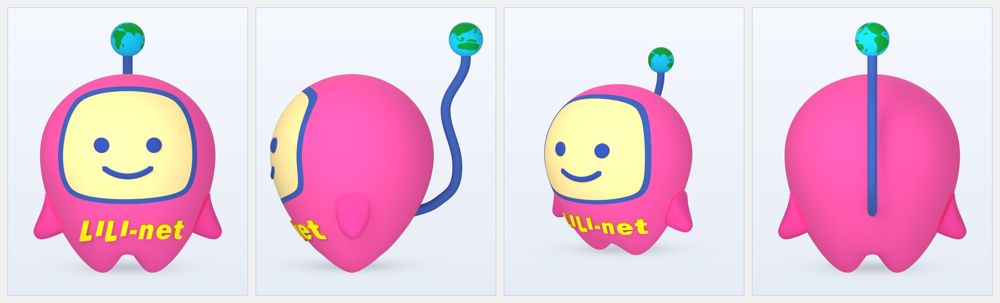
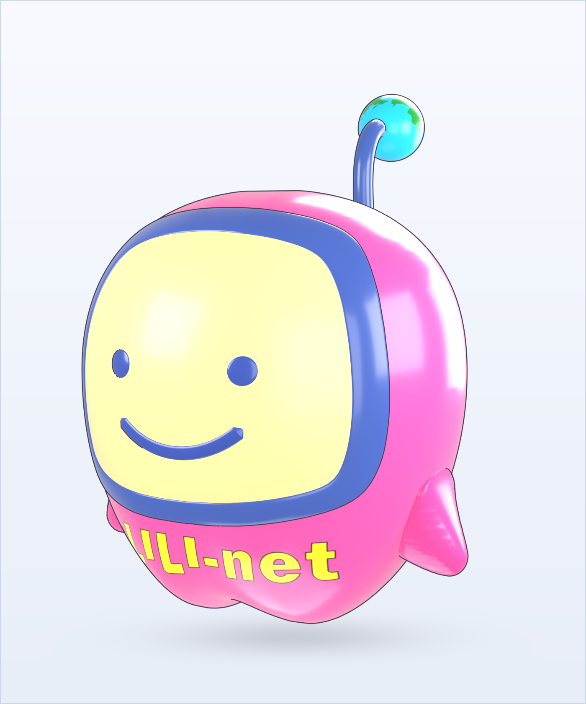
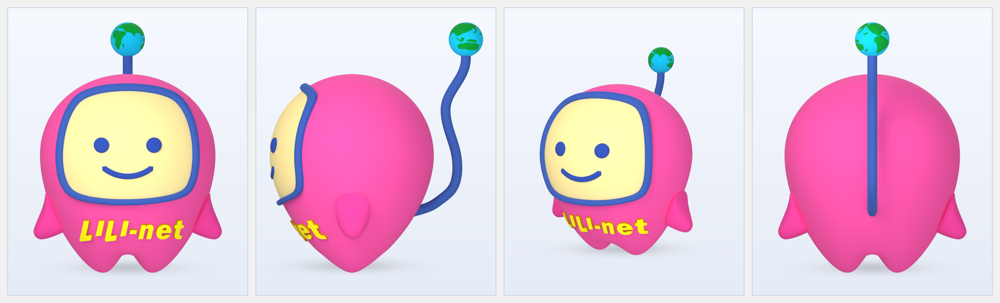
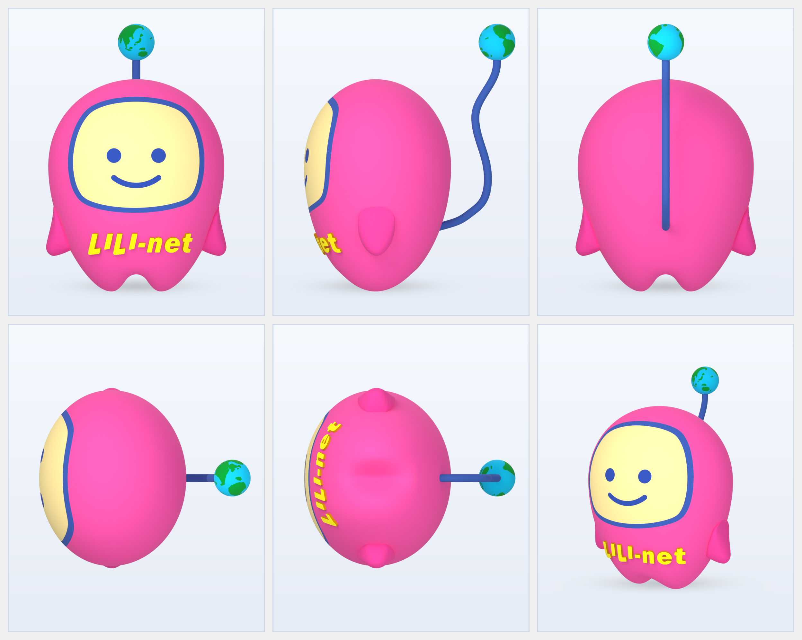

# 最終納品パッケージ：株式会社CVN 公式キャラクター「いい-NETくん（LILI-net）」3Dモデリング＆レンダリング制作（Rev.4 立体青枠版 ＆ 非立体フラット青枠版 全2バリエーション同梱）

- **納品日**: 2026年11月05日（Rev.4 立体青枠版 ＋ 非立体フラット青枠版）
- **格納場所**: `04_Delivery_Dept/outputs/`
- **法務・コンプライアンス審査**: `SKIPPED（通常案件・自社公式キャラクター3D制作）`
- **同梱・変換ファイル一覧（全2バリエーション）**:
  - **マスターパッケージ（本書）**: [`output_20261104_cvn_iinet_3d_modeling_full.md`](output_20261104_cvn_iinet_3d_modeling_full.md)
  - **【A】顔の青枠＝立体ベゼル仕様（Rev.4 標準版）**:
    - 斜め3/4 ヒーローレンダリング（1400×1680 px）: [`output_20261104_cvn_iinet_hero_3quarter.png`](output_20261104_cvn_iinet_hero_3quarter.png)（別名コピー: [`iinet_kun_hero_3quarter.png`](iinet_kun_hero_3quarter.png)）
    - 正面・側面・斜め・背面 4面比較ボード（3320×1008 px）: [`output_20261104_cvn_iinet_front_and_side.png`](output_20261104_cvn_iinet_front_and_side.png)（別名コピー: [`iinet_kun_front_and_side.png`](iinet_kun_front_and_side.png)）
    - 全6アングル統合シート（5面図＋斜め / 2496×1992 px）: [`output_20261104_cvn_iinet_5views_sheet.png`](output_20261104_cvn_iinet_5views_sheet.png)（別名コピー: [`iinet_kun_5views_sheet.png`](iinet_kun_5views_sheet.png)）
    - Blender 5.2 マスターファイル: [`output_20261104_cvn_iinet_kun.blend`](output_20261104_cvn_iinet_kun.blend)
    - Web / AR / 汎用3Dエンジン用 glTF 2.0 Binary: [`output_20261104_cvn_iinet_kun.glb`](output_20261104_cvn_iinet_kun.glb)
  - **【B】顔の青枠＝非立体フラット曲面仕様（`flat_frame` 別バージョン）**:
    - 斜め3/4 ヒーローレンダリング（1400×1680 px）: [`output_20261104_cvn_iinet_flat_frame_hero_3quarter.png`](output_20261104_cvn_iinet_flat_frame_hero_3quarter.png)（別名コピー: [`iinet_kun_flat_frame_hero_3quarter.png`](iinet_kun_flat_frame_hero_3quarter.png)）
    - 正面・側面・斜め・背面 4面比較ボード（3320×1008 px）: [`output_20261104_cvn_iinet_flat_frame_front_and_side.png`](output_20261104_cvn_iinet_flat_frame_front_and_side.png)（別名コピー: [`iinet_kun_flat_frame_front_and_side.png`](iinet_kun_flat_frame_front_and_side.png)）
    - 全6アングル統合シート（5面図＋斜め / 2496×1992 px）: [`output_20261104_cvn_iinet_flat_frame_5views_sheet.png`](output_20261104_cvn_iinet_flat_frame_5views_sheet.png)（別名コピー: [`iinet_kun_flat_frame_5views_sheet.png`](iinet_kun_flat_frame_5views_sheet.png)）
    - Blender 5.2 マスターファイル（非立体枠版）: [`output_20261104_cvn_iinet_kun_flat_frame.blend`](output_20261104_cvn_iinet_kun_flat_frame.blend)（別名コピー: [`cvn_iinet_kun_flat_frame.blend`](cvn_iinet_kun_flat_frame.blend)）
    - Web / AR / 汎用3Dエンジン用 glTF 2.0 Binary（非立体枠版）: [`output_20261104_cvn_iinet_kun_flat_frame.glb`](output_20261104_cvn_iinet_kun_flat_frame.glb)（別名コピー: [`cvn_iinet_kun_flat_frame.glb`](cvn_iinet_kun_flat_frame.glb)）

---

## エグゼクティブサマリー（全2バリエーションプレビュー・改修仕様・ボーン構成）

### 1. レンダリング画像プレビュー一覧

#### 【B】別バージョン：顔の青枠＝非立体フラット曲面仕様（`flat_frame` 版）

##### (B-1) 斜め3/4 ヒーローカット（非立体フラット青枠版）
- ファイル: [`output_20261104_cvn_iinet_flat_frame_hero_3quarter.png`](output_20261104_cvn_iinet_flat_frame_hero_3quarter.png) / [`iinet_kun_flat_frame_hero_3quarter.png`](iinet_kun_flat_frame_hero_3quarter.png)


##### (B-2) 正面・左側面・斜め3/4・背面 4面比較ボード（非立体フラット青枠版）
- ファイル: [`output_20261104_cvn_iinet_flat_frame_front_and_side.png`](output_20261104_cvn_iinet_flat_frame_front_and_side.png) / [`iinet_kun_flat_frame_front_and_side.png`](iinet_kun_flat_frame_front_and_side.png)


##### (B-3) 全6アングル統合シート（非立体フラット青枠版）
- ファイル: [`output_20261104_cvn_iinet_flat_frame_5views_sheet.png`](output_20261104_cvn_iinet_flat_frame_5views_sheet.png) / [`iinet_kun_flat_frame_5views_sheet.png`](iinet_kun_flat_frame_5views_sheet.png)


---

#### 【A】標準バージョン：顔の青枠＝立体ベゼル仕様（Rev.4 立体青枠版）

##### (A-1) 斜め3/4 ヒーローカット（立体青枠版）
- ファイル: [`output_20261104_cvn_iinet_hero_3quarter.png`](output_20261104_cvn_iinet_hero_3quarter.png) / [`iinet_kun_hero_3quarter.png`](iinet_kun_hero_3quarter.png)


##### (A-2) 正面・左側面・斜め3/4・背面 4面比較ボード（立体青枠版）
- ファイル: [`output_20261104_cvn_iinet_front_and_side.png`](output_20261104_cvn_iinet_front_and_side.png) / [`iinet_kun_front_and_side.png`](iinet_kun_front_and_side.png)


##### (A-3) 全6アングル統合シート（立体青枠版）
- ファイル: [`output_20261104_cvn_iinet_5views_sheet.png`](output_20261104_cvn_iinet_5views_sheet.png) / [`iinet_kun_5views_sheet.png`](iinet_kun_5views_sheet.png)


---

### 2. 全バリエーション共通およびバージョン別仕様サマリー

| 項目 | 改修要件・バリエーション仕様 | 3Dモデリング・マテリアル・レンダリングにおける実装仕様 |
| :--- | :--- | :--- |
| **① 顔の青枠（`Face_Frame`）＆画面（`Face_Screen`）の2バージョン展開** | **【A】立体青枠版**（ベゼル隆起あり）と、**【B】非立体フラット青枠版**（ボディ曲面に完全フラット密着）の2種類を別ファイルとして提供。 | ・**【A】立体青枠版**: 外径スケール `0.905倍`・枠幅係数 `0.54` のスリムな青枠を、ボディ表面から法線方向へ $+0.038\text{ m}$ ぷっくりと立体ベゼル状に隆起。<br>・**【B】非立体フラット青枠版（`flat_frame`）**: 青枠と画面の断面アーチ隆起を廃止し、両者をボディ前面曲面から均一な $+0.0007\text{ m}$（$0.7\text{ mm}$）の極薄コンフォーマル・フラッシュシェルとして同一面上に配置。さらに両オブジェクトの Cycles `visible_shadow = False` を設定し、ボディ表面法線と完全一致させることで、側面・上面・底面・斜めのどこから見ても青枠の出っ張りや段差影が一切ない滑らかなフラッシュ曲面を実現（目・口・胸元 `LILI-net` ロゴのぷっくりした3D立体感はそのまま維持）。 |
| **② ボディと足の付け根のへこみ完全解消（単一強凸曲面＋Taubin平滑化）** | 胴体下部と足の付け根にあった不自然なへこみ・くびれを完全に無くし、胴体から足先までツルンと滑らかに連続させる。 | 全区間 $u \in (0, 1)$ で二階微分 $f''(u) < 0$（変曲点ゼロ）を満たす**単一強凸プロファイル関数 `_f_convex_profile(u, alpha, delta)`** を導入。赤道（$Z=1.155\text{ m}$）から脇腹・お腹・お尻を通って丸く尖った足先（$X=\pm 0.258\text{ m}, Y=0.0\text{ m}, Z=-0.068\text{ m}$）まで1ミリの凹みもない一体造形を実現し、下半部へ20反復の体積保存型Taubinスムージングを適用。 |
| **③ 頭のラインの完全美化（$C^\infty$ 解析的ドーム曲線＋純粋楕円断面）** | 頭頂からこめかみ・側面にかけての階段ノイズや角張りを無くし、どの角度から見ても完璧に綺麗な丸い頭頂ラインにする。 | 上半球（$Z \ge Z_{\text{eq}}$）の水平・前後断面を純粋な楕円断面（`p=2.0`, `f_yz=1.0`）に統一し、正面頭頂プロファイルに **$C^\infty$ 解析的ドーム関数** $Z_{\text{top}}(|X|) = Z_{\text{eq}} + (Z_{\text{apex}} - Z_{\text{eq}})(1 - (|X|/W_{\max})^2)^{0.480}$ を採用。 |
| **④ 尻尾先端と地球儀の接続位置（地球儀の真下へ垂直接続）** | お尻から生えた尻尾（`Antenna`）の先端が、**地球儀の真下（南極点）**に繋がるようにする。 | お尻内部 $(Y=0.350\text{ m}, Z=0.490\text{ m})$ から表面を貫通し、背中下部ピーク ➔ 背中上部の谷部 ➔ 地球儀真下の直前 $(Z=2.155\text{ m}, Y=1.190\text{ m})$ を2段階の解析的余弦曲線（$C^1/C^2$ 連続）で滑らかに繋ぎ、そこから **$+Z$ 方向（真上）へ垂直に立ち上がって地球儀の真下（南極中心 $Z=2.1925\text{ m}$）へ接続**。 |
| **⑤ 立体目・口＋胸元 `LILI-net` 3D立体文字** | 目・口・胸元の `LILI-net` 文字をすべて3D立体メッシュとして造形する。 | パッチリ丸目（半径 $0.080\text{ m}$、厚み $+0.035\text{ m}$）、立体口（$+0.022\text{ m}$）、および滑らかなお腹の凸曲面に沿って $+0.024\text{ m}$ 張り出す独立3Dメッシュの `LILI-net` ロゴ（`Logo_LILI_net`）を配置。 |
| **⑥ 本格3DCGマット質感（Cycles GPU）＆全周360度地球儀テクスチャ** | アニメ調を排して3DCGマット陰影でレンダリングし、地球儀は全方向から海と大陸が見える全周360度仕様にする。 | Freestyle輪郭線と自己発光（`Emission`）を完全ゼロ化し、Cycles GPU パストレーシング＋4灯スタジオソフトボックス照明により `Roughness=0.94, Specular=0.08` の上品な3DCGマット質感でレンダリング。地球儀には全周360度に世界の大陸・島列を配置した `2048×1024 px` Equirectangularテクスチャを適用。 |

---

### 3. アニメーション用アーマチュア（`IINet_Armature`）ボーン構成（両バージョン共通・全11メッシュパーツ対応）

```text
IINet_Armature
└── Root (0, 0, -0.068) -> (0, 0, 0.18)
    └── Body (0, 0, 0.18) -> (0, 0, 1.90)
        │   [追従メッシュ: Body, Face_Screen, Face_Frame, Eye.L, Eye.R, Mouth, Logo_LILI_net]
        ├── Leg.L (+0.258, 0.0, 0.18) -> (+0.258, 0.0, -0.068)  [単一凸曲面で連続する丸く尖った左足スイング制御]
        ├── Leg.R (-0.258, 0.0, 0.18) -> (-0.258, 0.0, -0.068)  [単一凸曲面で連続する丸く尖った右足スイング制御]
        ├── Arm.L (+0.72, 0.0, 0.68)  -> (+0.96, 0.0, 0.32)     [左アーム パタパタ・曲げ制御]
        ├── Arm.R (-0.72, 0.0, 0.68)  -> (-0.96, 0.0, 0.32)     [右アーム パタパタ・曲げ制御]
        └── Antenna_1 -> Antenna_2 -> Antenna_3 -> Globe        [お尻貫通〜地球儀真下接続S字尻尾＆地球儀制御]
```

---

## Part 1. 完成コンテンツ本編（3Dモデリング＆レンダリング制作仕様書：立体青枠版 ＆ 非立体フラット青枠版）

- **制作年月**: 2026年11月
- **制作担当**: Creative部門（`02_Creative_Dept`）
- **使用環境**: Blender 5.2.3 LTS（Python API `bpy` / `bmesh` による完全プロシージャル構築・Cycles GPU レンダリング）

### 1. 成果物ファイル一覧（`04_Delivery_Dept/outputs/` 格納済）

#### 【A】顔の青枠＝立体ベゼル仕様（Rev.4 標準版）
| 種別 | 納品ファイルパス | 仕様・解像度 |
| :--- | :--- | :--- |
| **Blenderマスターファイル** | [`04_Delivery_Dept/outputs/output_20261104_cvn_iinet_kun.blend`](output_20261104_cvn_iinet_kun.blend) | Blender 5.2形式（立体青枠仕様：全11メッシュパーツ＋リグ＋Cycles 3Dマットマテリアル設定済） |
| **Web / AR用 3Dモデル** | [`04_Delivery_Dept/outputs/output_20261104_cvn_iinet_kun.glb`](output_20261104_cvn_iinet_kun.glb) | glTF 2.0 Binary形式（立体青枠仕様：11パーツ＋アーマチュア同梱） |
| **斜め3/4 ヒーローレンダリング** | [`04_Delivery_Dept/outputs/output_20261104_cvn_iinet_hero_3quarter.png`](output_20261104_cvn_iinet_hero_3quarter.png)<br>（同内容コピー: [`iinet_kun_hero_3quarter.png`](iinet_kun_hero_3quarter.png)） | `1400 × 1680 px`（立体青枠仕様・Cycles 3Dマット陰影・接地シャドウ付） |
| **正面・側面・斜め・背面 4面比較ボード** | [`04_Delivery_Dept/outputs/output_20261104_cvn_iinet_front_and_side.png`](output_20261104_cvn_iinet_front_and_side.png)<br>（同内容コピー: [`iinet_kun_front_and_side.png`](iinet_kun_front_and_side.png)） | `3320 × 1008 px`（立体青枠仕様・4パネル並列高解像度ボード） |
| **全6アングル統合シート（5面図＋斜め）** | [`04_Delivery_Dept/outputs/output_20261104_cvn_iinet_5views_sheet.png`](output_20261104_cvn_iinet_5views_sheet.png)<br>（同内容コピー: [`iinet_kun_5views_sheet.png`](iinet_kun_5views_sheet.png)） | `2496 × 1992 px`（立体青枠仕様・正面/側面/背面/上面/底面/斜め3/4） |

#### 【B】顔の青枠＝非立体フラット曲面仕様（`flat_frame` 別バージョン）
| 種別 | 納品ファイルパス | 仕様・解像度 |
| :--- | :--- | :--- |
| **Blenderマスターファイル（非立体枠版）** | [`04_Delivery_Dept/outputs/output_20261104_cvn_iinet_kun_flat_frame.blend`](output_20261104_cvn_iinet_kun_flat_frame.blend)<br>（同内容コピー: [`cvn_iinet_kun_flat_frame.blend`](cvn_iinet_kun_flat_frame.blend)） | Blender 5.2形式（非立体フラット青枠仕様：全11メッシュパーツ＋リグ＋Cycles 3Dマットマテリアル設定済） |
| **Web / AR用 3Dモデル（非立体枠版）** | [`04_Delivery_Dept/outputs/output_20261104_cvn_iinet_kun_flat_frame.glb`](output_20261104_cvn_iinet_kun_flat_frame.glb)<br>（同内容コピー: [`cvn_iinet_kun_flat_frame.glb`](cvn_iinet_kun_flat_frame.glb)） | glTF 2.0 Binary形式（非立体フラット青枠仕様：11パーツ＋アーマチュア同梱） |
| **斜め3/4 ヒーローレンダリング（非立体枠版）** | [`04_Delivery_Dept/outputs/output_20261104_cvn_iinet_flat_frame_hero_3quarter.png`](output_20261104_cvn_iinet_flat_frame_hero_3quarter.png)<br>（同内容コピー: [`iinet_kun_flat_frame_hero_3quarter.png`](iinet_kun_flat_frame_hero_3quarter.png)） | `1400 × 1680 px`（非立体フラット青枠仕様・Cycles 3Dマット陰影・接地シャドウ付） |
| **正面・側面・斜め・背面 4面比較ボード（非立体枠版）** | [`04_Delivery_Dept/outputs/output_20261104_cvn_iinet_flat_frame_front_and_side.png`](output_20261104_cvn_iinet_flat_frame_front_and_side.png)<br>（同内容コピー: [`iinet_kun_flat_frame_front_and_side.png`](iinet_kun_flat_frame_front_and_side.png)） | `3320 × 1008 px`（非立体フラット青枠仕様・4パネル並列高解像度ボード） |
| **全6アングル統合シート（非立体枠版）** | [`04_Delivery_Dept/outputs/output_20261104_cvn_iinet_flat_frame_5views_sheet.png`](output_20261104_cvn_iinet_flat_frame_5views_sheet.png)<br>（同内容コピー: [`iinet_kun_flat_frame_5views_sheet.png`](iinet_kun_flat_frame_5views_sheet.png)） | `2496 × 1992 px`（非立体フラット青枠仕様・正面/側面/背面/上面/底面/斜め3/4） |

---

## Part 2. 設計要件＆参照5面図仕様サマリー（`01_Research_Dept/inputs/task_20261104_cvn_iinet_3d_modeling.md` 準拠）

- **対象キャラクター**: 株式会社CVN キャラクター「いい-NETくん」（胸ロゴ：`LILI-net` ※「いい」を `LI` `LI` で表現したデザイン）
- **用途**: 広告チラシ用ビジュアル、およびアニメーション用3Dモデル
- **質感・トーン**: アニメ調を排した本格3DCGマット（つや消しラバー／クレイフィギュア）質感（Cycles GPU パストレーシング）
- **参照5面図アセット**:
  - `02_Creative_Dept/drafts/ref_images/05_front.png`（正面図）
  - `02_Creative_Dept/drafts/ref_images/03_side.png`（左側面図）
  - `02_Creative_Dept/drafts/ref_images/01_back.png`（背面図）
  - `02_Creative_Dept/drafts/ref_images/04_top.png`（上面図）
  - `02_Creative_Dept/drafts/ref_images/02_bottom.png`（底面図）
