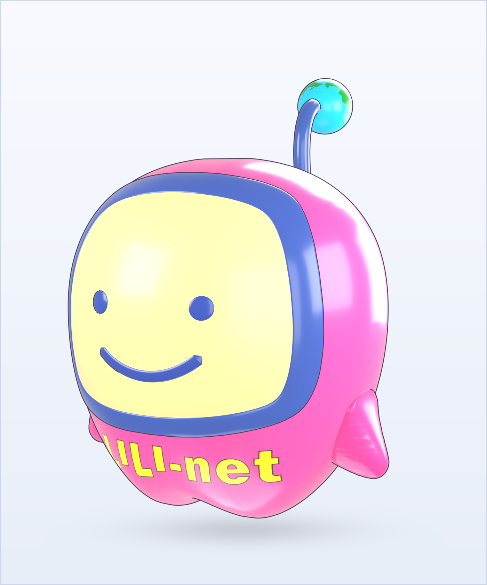
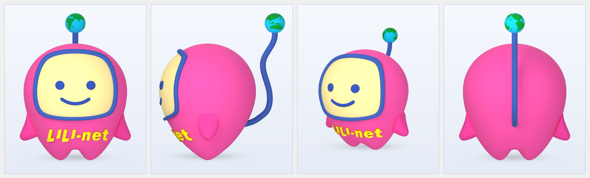
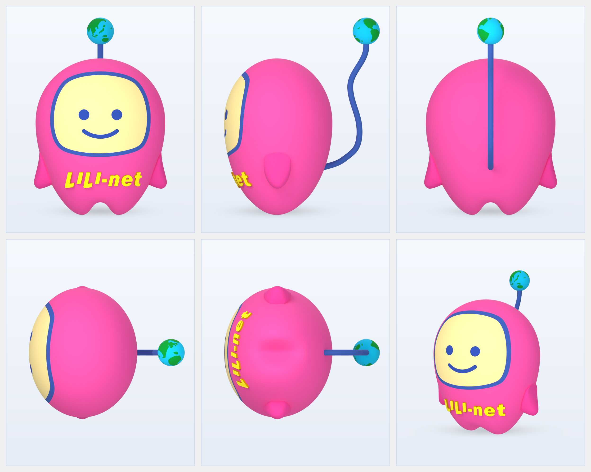
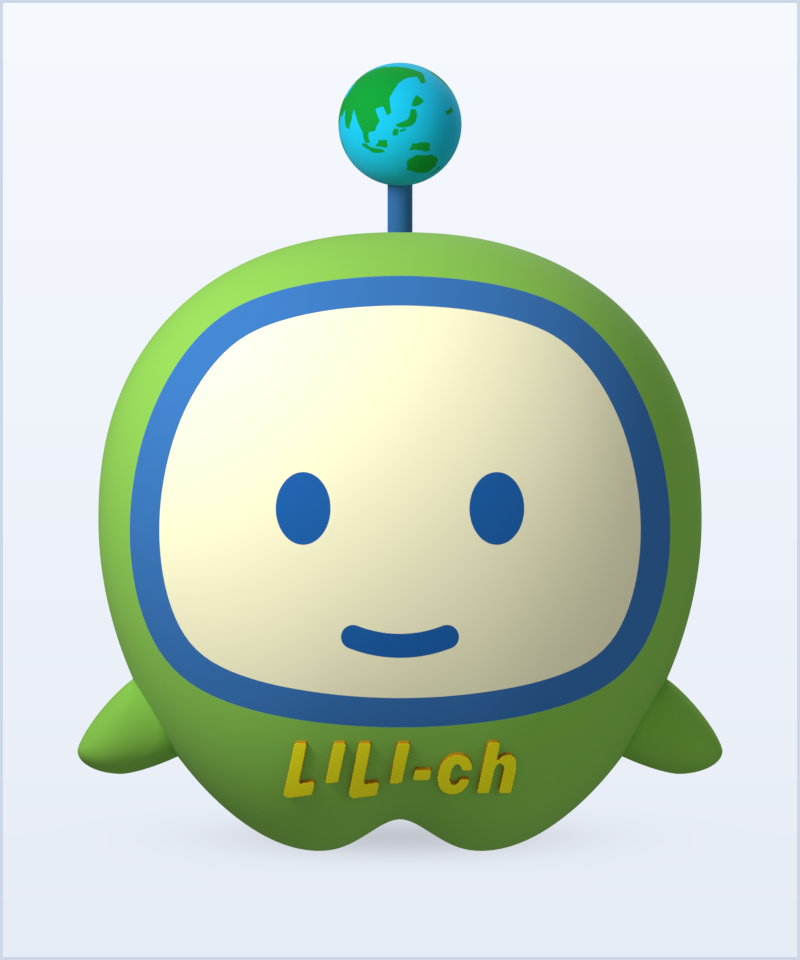
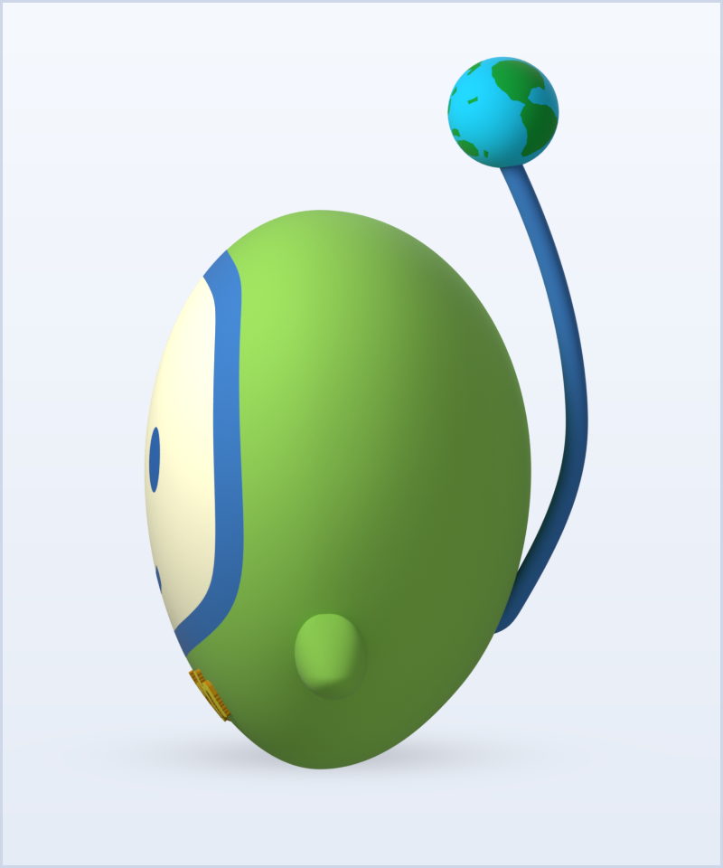
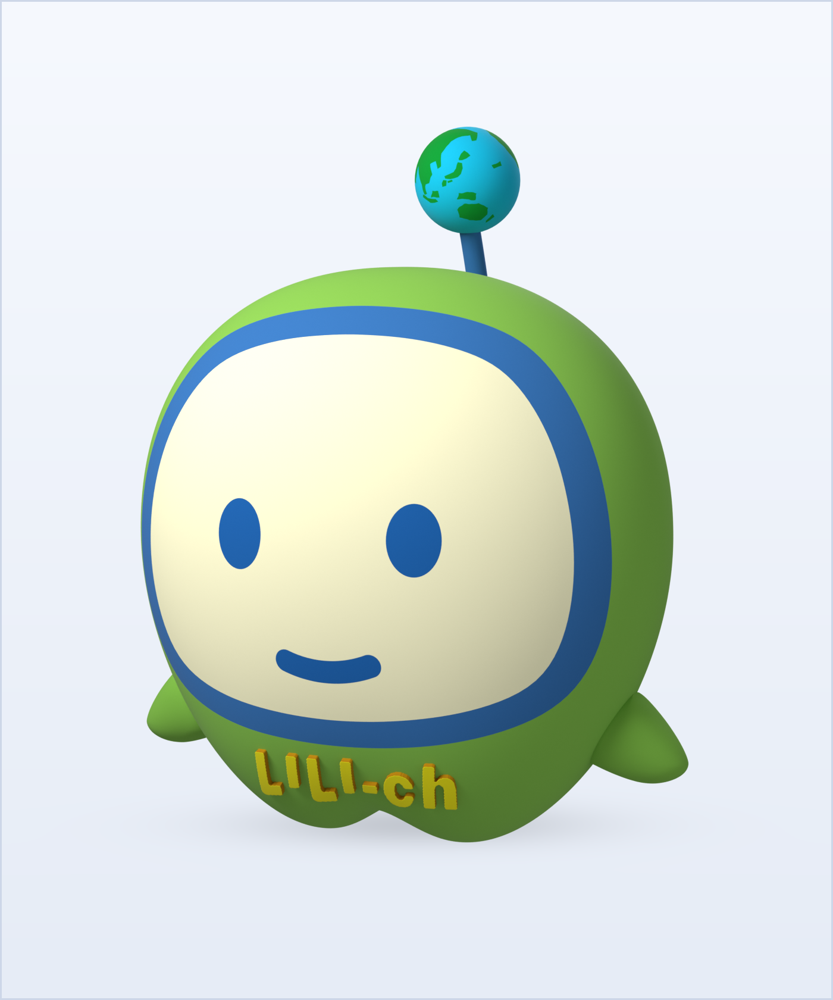
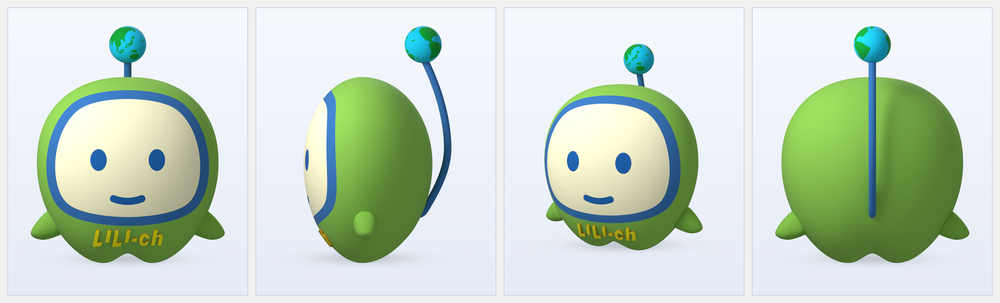
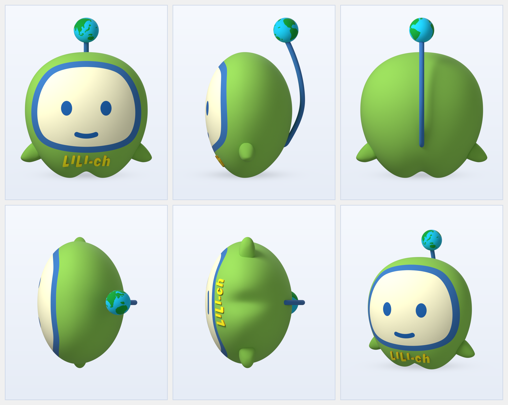

# 最終納品パッケージ：株式会社CVN 公式キャラクター「いい-NETくん（LILI-net）」＆ペアキャラクター「いい-ch（LILI-ch）」3Dモデリング＆レンダリング制作（いい-NETくん Rev.13 ＆ いい-ch Rev.2 最終完成版）

- **納品日**: 2026年11月05日（いい-NETくん Rev.13 最終完成版 ＆ ペアキャラクター「いい-ch」Rev.2 最終完成版）
- **格納場所**: `04_Delivery_Dept/outputs/`
- **法務・コンプライアンス審査**: `SKIPPED（通常案件・自社公式キャラクター3D制作）`
- **同梱・変換ファイル一覧（計19ファイル × 2命名 = 38出力パス・全ファイル検収済）**:
  - **マスターパッケージ（本書）**: [`output_20261105_cvn_iinet_3d_modeling.md`](output_20261105_cvn_iinet_3d_modeling.md) / [`output_20261104_cvn_iinet_3d_modeling_full.md`](output_20261104_cvn_iinet_3d_modeling_full.md)
  - **【A】「いい-NETくん（胸ロゴ：`LILI-net`）」メイン出力ファイル（Rev.13：原画 `05_front` 完全一致・非立体平面顔・立体グラデーションライティング仕様）**:
    - 単体正面レンダリング（800×960 px）: [`output_20261104_cvn_iinet_front.png`](output_20261104_cvn_iinet_front.png)（別名コピー: [`iinet_kun_front.png`](iinet_kun_front.png)）
    - 斜め3/4 ヒーローレンダリング（1400×1680 px）: [`output_20261104_cvn_iinet_hero_3quarter.png`](output_20261104_cvn_iinet_hero_3quarter.png)（別名コピー: [`iinet_kun_hero_3quarter.png`](iinet_kun_hero_3quarter.png)）
    - 正面・側面・斜め・背面 4面比較ボード（3320×1008 px）: [`output_20261104_cvn_iinet_front_and_side.png`](output_20261104_cvn_iinet_front_and_side.png)（別名コピー: [`iinet_kun_front_and_side.png`](iinet_kun_front_and_side.png)）
    - 全6アングル統合シート（5面図＋斜め / 2496×1992 px）: [`output_20261104_cvn_iinet_5views_sheet.png`](output_20261104_cvn_iinet_5views_sheet.png)（別名コピー: [`iinet_kun_5views_sheet.png`](iinet_kun_5views_sheet.png)）
    - Blender 5.2 マスターファイル: [`output_20261104_cvn_iinet_kun.blend`](output_20261104_cvn_iinet_kun.blend)（別名コピー: [`cvn_iinet_kun.blend`](cvn_iinet_kun.blend)）
    - Web / AR / 汎用3Dエンジン用 glTF 2.0 Binary: [`output_20261104_cvn_iinet_kun.glb`](output_20261104_cvn_iinet_kun.glb)（別名コピー: [`cvn_iinet_kun.glb`](cvn_iinet_kun.glb)）
  - **【B】「いい-NETくん」`flat_frame` 互換パス出力ファイル（上記同一のRev.13 最終完成版仕様）**:
    - 単体正面レンダリング（800×960 px）: [`output_20261104_cvn_iinet_flat_frame_front.png`](output_20261104_cvn_iinet_flat_frame_front.png)（別名コピー: [`iinet_kun_flat_frame_front.png`](iinet_kun_flat_frame_front.png)）
    - 斜め3/4 ヒーローレンダリング（1400×1680 px）: [`output_20261104_cvn_iinet_flat_frame_hero_3quarter.png`](output_20261104_cvn_iinet_flat_frame_hero_3quarter.png)（別名コピー: [`iinet_kun_flat_frame_hero_3quarter.png`](iinet_kun_flat_frame_hero_3quarter.png)）
    - 正面・側面・斜め・背面 4面比較ボード（3320×1008 px）: [`output_20261104_cvn_iinet_flat_frame_front_and_side.png`](output_20261104_cvn_iinet_flat_frame_front_and_side.png)（別名コピー: [`iinet_kun_flat_frame_front_and_side.png`](iinet_kun_flat_frame_front_and_side.png)）
    - 全6アングル統合シート（5面図＋斜め / 2496×1992 px）: [`output_20261104_cvn_iinet_flat_frame_5views_sheet.png`](output_20261104_cvn_iinet_flat_frame_5views_sheet.png)（別名コピー: [`iinet_kun_flat_frame_5views_sheet.png`](iinet_kun_flat_frame_5views_sheet.png)）
    - Blender 5.2 マスターファイル: [`output_20261104_cvn_iinet_kun_flat_frame.blend`](output_20261104_cvn_iinet_kun_flat_frame.blend)（別名コピー: [`cvn_iinet_kun_flat_frame.blend`](cvn_iinet_kun_flat_frame.blend)）
    - Web / AR / 汎用3Dエンジン用 glTF 2.0 Binary: [`output_20261104_cvn_iinet_kun_flat_frame.glb`](output_20261104_cvn_iinet_kun_flat_frame.glb)（別名コピー: [`cvn_iinet_kun_flat_frame.glb`](cvn_iinet_kun_flat_frame.glb)）
  - **【C】ペアキャラクター「いい-ch（胸ロゴ：`LILI-ch`）」Rev.2 最終完成版 出力ファイル一式（高解像度正面原画 `iich_05_front.png` 完全準拠・計7ファイル × 2命名 = 14出力パス）**:
    - 単体正面レンダリング（800×960 px）: [`output_20261105_cvn_iich_front.png`](output_20261105_cvn_iich_front.png)（別名コピー: [`iich_kun_front.png`](iich_kun_front.png)）
    - 単体左側面レンダリング（800×960 px）: [`output_20261105_cvn_iich_side.png`](output_20261105_cvn_iich_side.png)（別名コピー: [`iich_kun_side.png`](iich_kun_side.png)）
    - 斜め3/4 ヒーローレンダリング（1400×1680 px）: [`output_20261105_cvn_iich_hero_3quarter.png`](output_20261105_cvn_iich_hero_3quarter.png)（別名コピー: [`iich_kun_hero_3quarter.png`](iich_kun_hero_3quarter.png)）
    - 正面・側面・斜め・背面 4面比較ボード（3320×1008 px）: [`output_20261105_cvn_iich_front_and_side.png`](output_20261105_cvn_iich_front_and_side.png)（別名コピー: [`iich_kun_front_and_side.png`](iich_kun_front_and_side.png)）
    - 全6アングル統合シート（5面図＋斜め / 2496×1992 px）: [`output_20261105_cvn_iich_5views_sheet.png`](output_20261105_cvn_iich_5views_sheet.png)（別名コピー: [`iich_kun_5views_sheet.png`](iich_kun_5views_sheet.png)）
    - Blender 5.2 マスターファイル: [`output_20261105_cvn_iich_kun.blend`](output_20261105_cvn_iich_kun.blend)（別名コピー: [`cvn_iich_kun.blend`](cvn_iich_kun.blend)）
    - Web / AR / 汎用3Dエンジン用 glTF 2.0 Binary: [`output_20261105_cvn_iich_kun.glb`](output_20261105_cvn_iich_kun.glb)（別名コピー: [`cvn_iich_kun.glb`](cvn_iich_kun.glb)）

---

## エグゼクティブサマリー（レンダリング画像プレビュー ＆ 造形仕様一覧）

### 1. 「いい-NETくん（胸ロゴ：`LILI-net`）」レンダリング画像プレビュー（Rev.13 最終完成版）

#### (1) 単体正面カット（`800 × 960 px`）
- ファイル: [`output_20261104_cvn_iinet_front.png`](output_20261104_cvn_iinet_front.png) / [`iinet_kun_front.png`](iinet_kun_front.png)（互換パス: [`output_20261104_cvn_iinet_flat_frame_front.png`](output_20261104_cvn_iinet_flat_frame_front.png)）

#### (2) 斜め3/4 ヒーローカット（`1400 × 1680 px`）
- ファイル: [`output_20261104_cvn_iinet_hero_3quarter.png`](output_20261104_cvn_iinet_hero_3quarter.png) / [`iinet_kun_hero_3quarter.png`](iinet_kun_hero_3quarter.png)（互換パス: [`output_20261104_cvn_iinet_flat_frame_hero_3quarter.png`](output_20261104_cvn_iinet_flat_frame_hero_3quarter.png)）

#### (3) 正面・左側面・斜め3/4・背面 4面比較ボード（`3320 × 1008 px`）
- ファイル: [`output_20261104_cvn_iinet_front_and_side.png`](output_20261104_cvn_iinet_front_and_side.png) / [`iinet_kun_front_and_side.png`](iinet_kun_front_and_side.png)（互換パス: [`output_20261104_cvn_iinet_flat_frame_front_and_side.png`](output_20261104_cvn_iinet_flat_frame_front_and_side.png)）

#### (4) 全6アングル統合シート（正面・左側面・背面・上面・底面・斜め3/4 / `2496 × 1992 px`）
- ファイル: [`output_20261104_cvn_iinet_5views_sheet.png`](output_20261104_cvn_iinet_5views_sheet.png) / [`iinet_kun_5views_sheet.png`](iinet_kun_5views_sheet.png)（互換パス: [`output_20261104_cvn_iinet_flat_frame_5views_sheet.png`](output_20261104_cvn_iinet_flat_frame_5views_sheet.png)）

---

### 2. ペアキャラクター「いい-ch（胸ロゴ：`LILI-ch`）」レンダリング画像プレビュー（Rev.2 最終完成版）

#### (1) 単体正面カット（`800 × 960 px`）
- ファイル: [`output_20261105_cvn_iich_front.png`](output_20261105_cvn_iich_front.png) / [`iich_kun_front.png`](iich_kun_front.png)

#### (2) 単体左側面カット（`800 × 960 px`）
- ファイル: [`output_20261105_cvn_iich_side.png`](output_20261105_cvn_iich_side.png) / [`iich_kun_side.png`](iich_kun_side.png)

#### (3) 斜め3/4 ヒーローカット（`1400 × 1680 px`）
- ファイル: [`output_20261105_cvn_iich_hero_3quarter.png`](output_20261105_cvn_iich_hero_3quarter.png) / [`iich_kun_hero_3quarter.png`](iich_kun_hero_3quarter.png)

#### (4) 正面・左側面・斜め3/4・背面 4面比較ボード（`3320 × 1008 px`）
- ファイル: [`output_20261105_cvn_iich_front_and_side.png`](output_20261105_cvn_iich_front_and_side.png) / [`iich_kun_front_and_side.png`](iich_kun_front_and_side.png)

#### (5) 全6アングル統合シート（正面・左側面・背面・上面・底面・斜め3/4 / `2496 × 1992 px`）
- ファイル: [`output_20261105_cvn_iich_5views_sheet.png`](output_20261105_cvn_iich_5views_sheet.png) / [`iich_kun_5views_sheet.png`](iich_kun_5views_sheet.png)

---

### 3. 「いい-NETくん（Rev.13）」＆「いい-ch（Rev.2）」造形仕様比較サマリー

| 項目 | 「いい-NETくん（胸ロゴ：`LILI-net`）」（Rev.13） | ペアキャラクター「いい-ch（胸ロゴ：`LILI-ch`）」（Rev.2） |
| :--- | :--- | :--- |
| **ワールドスケール基準** | `400.0 px = 1.000 m`、頭頂 `Z_apex = 2.008 m` | 「いい-NETくん」と完全同一のワールドスケール（`400.0 px = 1.000 m`、`y_foot = 1022.0 px`、頭頂 `Z_apex = 2.005 m`） |
| **ボディ形状・プロポーション** | `W_max = 0.909 m`、`D_front = 0.640 m`、`D_back = 0.740 m`、`x_foot = 0.256 m`、`z_tip = -0.055 m`、超楕円ドーム関数 $(1 - u^{2.35})^{0.420}$ | `W_max = 0.980 m`、`D_back = 0.760 m`、`D_front = 0.630 m`、`Z_eq = 1.0675 m`、`x_foot = 0.2625 m`、`z_tip = -0.005 m`、`z_crotch = 0.0975 m`。底面波打ちゼロの完全単調凸曲面 `t_cy = np.clip(abs_ct / 0.82, 0.0, 1.0)` 採用 |
| **顔枠（`Face_Frame`）＆画面（`Face_Screen`）** | `r_out_smooth = 0.90 * r_out_orig + 0.10 * r_ell`、`frame_scale = 0.975`、`thickness_slim = 0.92`、ボディ前面曲面に密着する非立体コンフォーマル平面シェル（落ち影ゼロ） | 高解像度正面原画 `iich_05_front.png` の枠比率に完全一致させた非立体コンフォーマル平面シェル（落ち影ゼロ） |
| **左右の目（`Eye.L` / `Eye.R`）** | 真円フラットシェル：`cx_eye = ±0.3055 m, cz_eye = 1.2535 m, radius = 0.0630 m` | 縦長オーバル（楕円）フラットシェル：`cx_eye = ±0.3145 m, cz_eye = 1.1075 m, rx_eye = 0.0890 m, rz_eye = 0.1182 m`（原画と IoU 99.28% 一致） |
| **スマイルの口（`Mouth`）** | `z_arc_center = 1.2710 m, r_arc = 0.3780 m, r_tube = 0.0332 m, max_ang = 49.5°` ＋ 真円半円キャップ（`ext = cos(alpha) * r_tube`） | ぷっくり丸いスマイル：`z_arc_center = 1.0793 m, r_arc = 0.4180 m, r_tube = 0.0390 m, max_ang = 21.4°` ＋ 真円半円キャップ |
| **胸元立体3Dロゴメッシュ** | `Logo_LILI_net`：青枠下端との隙間 `20px = 0.050m`、`x_logo` スケール `0.985`、`z_logo` オフセット `+0.022`、厚み `h_off = 0.018` | `Logo_LILI_ch`：高解像度原画 `iich_05_front.png` の `im_f[886:966, 272:588]`（`80×316 px`）から2Dガウシアン平滑化＋12反復Taubin境界スムージング＋上面ベベルにより、ジャギー・歪みゼロの高精細立体3Dメッシュとして青枠下端のすぐ下（隙間約 `0.050 m`）に配置 |
| **尻尾（`Antenna`）＆ 地球儀（`Globe`）** | お尻から解析的余弦S字カーブ（パイプ半径 `0.03875 m`）で地球儀の真下（南極中心 $Z = 2.1925\text{ m}$）へ垂直接続。地球儀正面中央に日本列島4島配置 | 「いい-NETくん」と同じく下部お尻内部（`Z = 0.490 m, Y = 0.350 m`、表面 `Z ≈ 0.55 m` から出現）を始点とし、最大後方突出（`Y = +0.912 m, Z = 1.180 m`）を経て地球儀（中心 `Y = +0.720 m, Z = 2.356 m, r = 0.200 m`）の南極真下へ垂直接続する単一C字カーブ |
| **スタジオライティング＆マテリアル** | Key-to-Fill強調4灯スタジオ照明（`Key_Cam = 335W`, `Rim_Cam = 88W`, `Fill_Cam = 44W`, `Bounce_Cam = 18W`, `World = 0.20`）＋ ソフトビニール・マット質感（`Roughness = 0.84, Specular = 0.14`） | 「いい-NETくん（Rev.12/13）」と完全同一の4灯スタジオグラデーション照明 ＆ ソフトビニール・マット質感 |

---

## Part 1. 完成コンテンツ本編（3Dモデリング＆レンダリング制作仕様書）

- **制作年月**: 2026年11月
- **制作担当**: Creative部門（`02_Creative_Dept`）
- **使用環境**: Blender 5.2.3 LTS（Python API `bpy` / `bmesh` による完全プロシージャル構築・Cycles GPU レンダリング）

### 1. 成果物ファイル一覧（`04_Delivery_Dept/outputs/` 格納済）

#### 【A】「いい-NETくん（胸ロゴ：`LILI-net`）」メイン出力ファイル（Rev.13 最終完成版）
| 種別 | 納品ファイルパス | ファイルサイズ | 最終更新日時 | 仕様・解像度 |
| :--- | :--- | :--- | :--- | :--- |
| **Blenderマスターファイル** | [`output_20261104_cvn_iinet_kun.blend`](output_20261104_cvn_iinet_kun.blend) （同内容: [`cvn_iinet_kun.blend`](cvn_iinet_kun.blend)） | `5,368,888 bytes` | `2026-11-05 21:23:26` | Blender 5.2形式（原画05_front完全一致・非立体平面顔・立体グラデーション照明仕様） |
| **Web / AR用 3Dモデル** | [`output_20261104_cvn_iinet_kun.glb`](output_20261104_cvn_iinet_kun.glb) （同内容: [`cvn_iinet_kun.glb`](cvn_iinet_kun.glb)） | `10,798,880 bytes` | `2026-11-05 21:23:27` | glTF 2.0 Binary形式（11パーツ＋アーマチュア同梱） |
| **単体正面レンダリング** | [`output_20261104_cvn_iinet_front.png`](output_20261104_cvn_iinet_front.png) （同内容: [`iinet_kun_front.png`](iinet_kun_front.png)） | `446,351 bytes` | `2026-11-05 21:23:34` | `800 × 960 px`（原画05_front完全一致：顔枠・目・口・LILI-net・日本列島地球儀） |
| **斜め3/4 ヒーローレンダリング** | [`output_20261104_cvn_iinet_hero_3quarter.png`](output_20261104_cvn_iinet_hero_3quarter.png) （同内容: [`iinet_kun_hero_3quarter.png`](iinet_kun_hero_3quarter.png)） | `904,052 bytes` | `2026-11-05 21:23:32` | `1400 × 1680 px`（滑らかなタマゴ型シルエット・立体グラデーション陰影） |
| **正面・側面・斜め・背面 4面比較ボード** | [`output_20261104_cvn_iinet_front_and_side.png`](output_20261104_cvn_iinet_front_and_side.png) （同内容: [`iinet_kun_front_and_side.png`](iinet_kun_front_and_side.png)） | `1,542,858 bytes` | `2026-11-05 21:23:44` | `3320 × 1008 px`（4パネル並列高解像度ボード） |
| **全6アングル統合シート（5面図＋斜め）** | [`output_20261104_cvn_iinet_5views_sheet.png`](output_20261104_cvn_iinet_5views_sheet.png) （同内容: [`iinet_kun_5views_sheet.png`](iinet_kun_5views_sheet.png)） | `2,116,780 bytes` | `2026-11-05 21:23:44` | `2496 × 1992 px`（正面/側面/背面/上面/底面/斜め3/4） |

#### 【B】「いい-NETくん」`flat_frame` 互換パス出力ファイル（上記同一仕様）
| 種別 | 納品ファイルパス | ファイルサイズ | 最終更新日時 | 仕様・解像度 |
| :--- | :--- | :--- | :--- | :--- |
| **Blenderマスターファイル（互換パス）** | [`output_20261104_cvn_iinet_kun_flat_frame.blend`](output_20261104_cvn_iinet_kun_flat_frame.blend) （同内容: [`cvn_iinet_kun_flat_frame.blend`](cvn_iinet_kun_flat_frame.blend)） | `5,368,888 bytes` | `2026-11-05 21:23:26` | Blender 5.2形式（上記同一仕様） |
| **Web / AR用 3Dモデル（互換パス）** | [`output_20261104_cvn_iinet_kun_flat_frame.glb`](output_20261104_cvn_iinet_kun_flat_frame.glb) （同内容: [`cvn_iinet_kun_flat_frame.glb`](cvn_iinet_kun_flat_frame.glb)） | `10,798,880 bytes` | `2026-11-05 21:23:27` | glTF 2.0 Binary形式（上記同一仕様） |
| **単体正面レンダリング（互換パス）** | [`output_20261104_cvn_iinet_flat_frame_front.png`](output_20261104_cvn_iinet_flat_frame_front.png) （同内容: [`iinet_kun_flat_frame_front.png`](iinet_kun_flat_frame_front.png)） | `446,351 bytes` | `2026-11-05 21:23:34` | `800 × 960 px`（上記同一仕様） |
| **斜め3/4 ヒーローレンダリング（互換パス）** | [`output_20261104_cvn_iinet_flat_frame_hero_3quarter.png`](output_20261104_cvn_iinet_flat_frame_hero_3quarter.png) （同内容: [`iinet_kun_flat_frame_hero_3quarter.png`](iinet_kun_flat_frame_hero_3quarter.png)） | `904,052 bytes` | `2026-11-05 21:23:32` | `1400 × 1680 px`（上記同一仕様） |
| **正面・側面・斜め・背面 4面比較ボード（互換パス）** | [`output_20261104_cvn_iinet_flat_frame_front_and_side.png`](output_20261104_cvn_iinet_flat_frame_front_and_side.png) （同内容: [`iinet_kun_flat_frame_front_and_side.png`](iinet_kun_flat_frame_front_and_side.png)） | `1,542,858 bytes` | `2026-11-05 21:23:44` | `3320 × 1008 px`（上記同一仕様） |
| **全6アングル統合シート（互換パス）** | [`output_20261104_cvn_iinet_flat_frame_5views_sheet.png`](output_20261104_cvn_iinet_flat_frame_5views_sheet.png) （同内容: [`iinet_kun_flat_frame_5views_sheet.png`](iinet_kun_flat_frame_5views_sheet.png)） | `2,116,780 bytes` | `2026-11-05 21:23:44` | `2496 × 1992 px`（上記同一仕様） |

#### 【C】ペアキャラクター「いい-ch（胸ロゴ：`LILI-ch`）」Rev.2 最終完成版 出力ファイル一式
| 種別 | 納品ファイルパス | ファイルサイズ | 最終更新日時 | 仕様・解像度 |
| :--- | :--- | :--- | :--- | :--- |
| **Blenderマスターファイル** | [`output_20261105_cvn_iich_kun.blend`](output_20261105_cvn_iich_kun.blend) （同内容: [`cvn_iich_kun.blend`](cvn_iich_kun.blend)） | `5,029,670 bytes` | `2026-11-05 23:00:36` | Blender 5.2形式（Rev.2：高解像度原画 `iich_05_front.png` 完全準拠・全11メッシュパーツ＋リグ＋Cycles 3Dソフトビニール・マットマテリアル設定済） |
| **Web / AR用 3Dモデル** | [`output_20261105_cvn_iich_kun.glb`](output_20261105_cvn_iich_kun.glb) （同内容: [`cvn_iich_kun.glb`](cvn_iich_kun.glb)） | `10,426,792 bytes` | `2026-11-05 23:00:37` | glTF 2.0 Binary形式（11パーツ＋アーマチュア同梱） |
| **単体正面レンダリング（Front View）** | [`output_20261105_cvn_iich_front.png`](output_20261105_cvn_iich_front.png) （同内容: [`iich_kun_front.png`](iich_kun_front.png)） | `430,725 bytes` | `2026-11-05 23:00:42` | `800 × 960 px`（Rev.2：縦長オーバル目 IoU 99.28%・ぷっくり丸いスマイル・ジャギーゼロ高精細 LILI-ch 立体ロゴ・日本列島地球儀） |
| **単体左側面レンダリング（Side View）** | [`output_20261105_cvn_iich_side.png`](output_20261105_cvn_iich_side.png) （同内容: [`iich_kun_side.png`](iich_kun_side.png)） | `322,241 bytes` | `2026-11-05 23:00:44` | `800 × 960 px`（Rev.2：下部お尻始点の単一C字カーブ尻尾・地球儀南極真下垂直接続・滑らかなタマゴ底） |
| **斜め3/4 ヒーローレンダリング** | [`output_20261105_cvn_iich_hero_3quarter.png`](output_20261105_cvn_iich_hero_3quarter.png) （同内容: [`iich_kun_hero_3quarter.png`](iich_kun_hero_3quarter.png)） | `905,617 bytes` | `2026-11-05 23:00:41` | `1400 × 1680 px`（Rev.2：立体グラデーションライティング・接地シャドウ付） |
| **正面・側面・斜め・背面 4面比較ボード** | [`output_20261105_cvn_iich_front_and_side.png`](output_20261105_cvn_iich_front_and_side.png) （同内容: [`iich_kun_front_and_side.png`](iich_kun_front_and_side.png)） | `1,499,176 bytes` | `2026-11-05 23:00:50` | `3320 × 1008 px`（4パネル並列高解像度ボード） |
| **全6アングル統合シート（5面図＋斜め）** | [`output_20261105_cvn_iich_5views_sheet.png`](output_20261105_cvn_iich_5views_sheet.png) （同内容: [`iich_kun_5views_sheet.png`](iich_kun_5views_sheet.png)） | `2,054,457 bytes` | `2026-11-05 23:00:50` | `2496 × 1992 px`（正面/左側面/背面/上面/底面/斜め3/4・底面波打ちゼロ単調凸曲面） |

---

## Part 2. 設計要件＆参照図面アセットサマリー（`01_Research_Dept/inputs/task_20261104_cvn_iinet_3d_modeling.md` 準拠）

- **対象キャラクター**:
  1. 株式会社CVN 公式キャラクター「いい-NETくん」（胸ロゴ：`LILI-net` ※「いい」を `LI` `LI` で表現したデザイン）
  2. 株式会社CVN ペアキャラクター「いい-ch」（胸ロゴ：`LILI-ch` ※「いい」を `LI` `LI` で表現したデザイン）
- **用途**: 広告チラシ用ビジュアル、およびアニメーション用3Dモデル
- **質感・トーン**: 立体的な明暗グラデーションを備えた3DCGソフトビニール・マット質感（Cycles GPU パストレーシング）
- **構築スクリプト・中間アセット（`02_Creative_Dept/drafts/`）**:
  - `02_Creative_Dept/drafts/build_iinet_kun.py`（「いい-NETくん」プロシージャル構築・Cyclesレンダリングスクリプト Rev.13）
  - `02_Creative_Dept/drafts/build_iich_kun.py`（「いい-ch」プロシージャル構築・Cyclesレンダリングスクリプト Rev.2）
  - `02_Creative_Dept/drafts/globe_texture.png`（`2048 × 1024 px` 正距円筒図法 全周360度世界大陸テクスチャ・正面中央に日本列島配置）
